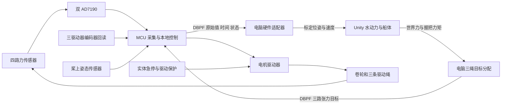

# 船桨力反馈装置：嵌入式接入交接

这次先接三绳船桨装置。目标是让电脑取得**真实桨的运动和三路实际张力**，再把水动力换算出的三路张力目标交给设备执行。最终体验是人自由持桨、只在边界接触限位；中心测量绳不参与电机驱动力分配。本阶段不接真实六自由度平台。

仓库已经有 Unity 水动力与软件闭环、原生机构 CAD、六页采集板原理图、AD7190 解析工具，以及本次新增的硬件通信约定和离线对包工具。**当前没有真实电机固件，也没有消费新 DBPF 协议的 Unity 硬件适配器。** 按下文分工把这两部分接起来；桌面演示能运行不代表电机能接上。

现有 CAD 的三绳受力方向存在已证实的不可达目标，三绳保真仍是 **FIDELITY FAIL**。这不妨碍先做采集和单电机台架，但在真人受载之前必须完成本文“三绳与自由桨联调”中的方向能力核验。

## 接手当天，从这里开始

已有仓库就在仓库根目录打开 PowerShell；新电脑先执行：

```powershell
git clone https://github.com/KWM925-ui/vr.git
Set-Location vr
python.exe --version
python.exe -m unittest discover -s tools -p test_paddle_hardware.py
python.exe -m unittest discover -s tools -p test_adc_replay.py
python.exe tools/paddle_hardware.py check hardware/paddle/examples/telemetry.bin --allow-simulated
python.exe tools/paddle_hardware.py inspect hardware/paddle/examples/stop.bin
```

这几条只需 Python 3.11+ 标准库，不需要 Unity、SolidWorks、NumPy 或任何硬件。前两组测试应通过；样包检查输出 `CAPTURE_STRUCTURE_AND_IDENTITIES_PASS`，并明确 `hardware_acceptance=false`。样包是模拟数据，最后一条只显示停止包内容，不发送指令。

接着打开 [原理图](reference/SCH_Schematic1_2026-09-22.pdf)，照“采集板接线”核对手上的板子。先只给采集板供电，电机功率侧保持断开，完成 USB 枚举、两片 ADC 寄存器读回和四路原始数据采集。机械／电气同事同时核对电机铭牌、驱动器和三条真实绳路。这些工作可以并行。

协议字段、字节序、CRC 和使能规则以 [PROTOCOL.md](PROTOCOL.md) 为唯一接口定义；[examples/golden_vectors.json](examples/golden_vectors.json) 给出完整十六进制帧，供固件逐字节对照。

## 分工与完整数据流

| 负责方 | 本轮必须完成的工作 | 交给下一方的实际结果 |
|---|---|---|
| 嵌入式 | 板卡启动、ADC／编码器／IMU 驱动、DBPF 收发、本地单电机张力控制、故障与停机状态机 | 固件源、可复现的编译烧录方法、真实原始记录、寄存器读回、配置与标定、单路台架结果 |
| 机械／电气，与嵌入式一起 | 确认实物与 CAD 差异、绳路和通道编号、驱动器接线、承载与行程、急停和制动、位置基准 | 带编号的实物照片／接线图、驱动器手册与参数备份、实际尺寸和允许台架范围 |
| 电脑／Unity 开发 | 接收真实观测、时钟和坐标转换、求桨位姿、三绳目标分配、硬件适配器、过程记录与生命周期停机 | 能用真实桨驱动画面、下发有来源的目标，并显示实际响应及误差的候选程序 |
| 三方联调 | 逐路对应、标定复核、不可达方向核验、通信异常和结束体验测试 | 同一固件／配置／程序版本下可复核的联调结果；通过台架后再进入人体体验 |



MCU 不计算河流、波浪和船体物理。电脑不通过逐帧串口写 PWM 来替代驱动器内环。电流／扭矩内环优先使用驱动器已实现的控制模式；外部张力环放在本地，频率依据真实传感更新率和驱动响应确定。

## 机构怎么对应实物

打开主装配 [2.1 铝型材框架.SLDASM](<../../10月11日修改/2.1 铝型材框架.SLDASM>)，零件在同一个 [原生 CAD 目录](../../10月11日修改)。原件保持原文件名，装配引用不作重命名。

CAD 中有三只电机和三只玻纤卷轮。设计实例关系如下，**实例尾号不是软件电机编号**：

| CAD 电机实例 | CAD 机械连接 |
|---|---|
| 电机 `-1` | 胀套 `-1` → 玻纤轮 `-3` |
| 电机 `-2` | 胀套 `-3` → 玻纤轮 `-5` |
| 电机 `-3` | 玻纤轮 `-1` |

电机设计文件名包含 `米格130ST-M10010`，不能据此确认实际电机铭牌、额定扭矩、编码器协议或驱动器型号。机械／电气人员拍下三台电机及驱动器铭牌，导出驱动器当前参数，依据厂商手册确定供电、信号端子和控制模式。采集板原理图里没有这三台电机的功率驱动和已确认的电机总线。

现场逐根追踪“驱动器 → 电机 → 卷轮 → 所有滑轮 → 最后出绳点 → 桨上拴点 → 测力通道”，两端贴 M1、M2、M3 标签；断电手动拉动一根绳，记录哪一路编码器和测力值变化。把实际对应填入 [device.example.json](config/device.example.json) 的副本，不能凭 CAD 排列顺序填写。

桨 `1.34 船桨-2` 的三处驱动拴点相对桨尖为：杆孔 `(0, 0.46, 0)` m、两侧孔 `(±0.08, 0.01, 0)` m；中心孔供测量绳使用。`1.27 拉线盒-IP54 BRT38 2m.stp-1` 和 `1.76 姿态传感器-1` 说明设计中各有一只相应器件，不说明实物已装好、接口已确定或已经标定。

卷轮 [1.11 玻纤轮-R22-D50-d42.SLDPRT](<../../10月11日修改/1.11 玻纤轮-R22-D50-d42.SLDPRT>) 经原生曲面和草图核对：槽底半径 **95 mm**、槽宽 **1.2 mm**、外缘半径 **105 mm**。仅在圆绳贴槽底、单层且绳径能放进槽的条件下，绳中心半径才在大于 95 mm、至多 95.6 mm 的范围内；不能把文件名、外缘半径或这个条件范围直接写成实物有效卷径。

例如软件的 300 N 乘 0.095 m，理想卷轴负载就有 28.5 N·m，尚未计摩擦、惯量或传动。这只是说明必须核对驱动能力，**不是允许实机输出 300 N**。放绳受拉时还可能回馈能量，电源、驱动器和制动／能量吸收方案由电气人员按实际型号核对。

末级万向导轮外半径约 24 mm、原生槽底半径约 16.7996 mm。旧细线实体与导轮位置不一致，不能用其端点代替实物最后切点。实际绳路、导轮转向和安装位置要由现场量取。

## 采集板接线

以下来自六页 [原理图](reference/SCH_Schematic1_2026-09-22.pdf)，是设计接线；先核对 PCB 版本、器件丝印和通断，再接线。第 1 页为 MCU，第 2 页为 USB，第 3／6 页为电源，第 4 页为 ADC，第 5 页为测力接头。

主控为 ESP32-S3-WROOM-1-N16R8。TYPE-C 经 CH334R Hub 分出原生 USB 和 CH340K；第一版 DBPF 使用原生 USB CDC，UART0／CH340K 留作下载和调试。USB 数据流里不得混入 `printf` 文本。

| 信号 | ESP32-S3／板上连接 |
|---|---|
| USB D− / D+ | GPIO19 / GPIO20 |
| 调试与下载 | U0TXD / U0RXD 经 CH340K，DTR／RTS 用于自动下载 |
| SPI MOSI / SCLK | GPIO11 / GPIO12 |
| SPI MISO、AD7190 DOUT/RDY | GPIO13，两片 ADC 共用 |
| U7 / U8 片选 | GPIO10 / GPIO9 |
| 两片 ADC SYNC | GPIO14 |
| AD7190 模拟电源 / 数字电源 | +5V_A / 3V3 |
| ADC 激励／参考 | REFIN1 取激励供电；REFIN2、AINCOM、BPDSW 未接 |
| ADC 时钟 | X2／X3 标注外部 4.91 MHz 晶体；实际频率依据 BOM／测量填写 |

两片 ADC 共用 DOUT/RDY：任何时刻只选中一片，并按数据手册核对未选中时的总线行为；不能同时拉低两路 CS。SYNC 同步启动也不等于四路测量同时完成，两个通道轮询和独立晶体的时间差仍须记录。

四路接头的引脚定义相同：

| 接头脚号 | 原理图网络 | 用途 |
|---:|---|---|
| 1 | SHIELD | 屏蔽层，按板图及实际传感器屏蔽方案接入 |
| 2 | SIG_N | 差分信号负 |
| 3 | SIG_P | 差分信号正 |
| 4 | EXC_N | 桥式传感器激励负 |
| 5 | EXC_P | 桥式传感器激励正 |

| 接头 | ADC 差分输入 |
|---|---|
| CH1 | U7：AIN1 − AIN2 |
| CH2 | U7：AIN3 − AIN4 |
| CH3 | U8：AIN1 − AIN2 |
| CH4 | U8：AIN3 − AIN4 |

按接插件脚号确认插合面与焊接面，不能按线色猜正负。先确认传感器允许的激励电压、桥路阻抗和满量程输出，再供激励。输入各腿有 200 Ω、电路有差分 100 nF 和共模 10 nF；这是输入滤波网络，不代表其后整条采样链已满足力控带宽。

CH1～CH4 是电路编号，与 M1～M3 的实物对应要实测填写。第四路目前没有确定用途；不能默认它就是握力、不能将四路相加当总水阻。

## 固件先做什么

先检查嵌入式团队有没有该板已能工作的底层工程。有则保留可靠的底层驱动，在外面实现 DBPF；没有则为 ESP32-S3 建立 ESP-IDF 工程。建议把最终源码放入仓库 `firmware/paddle/`，固定 ESP-IDF 版本、组件版本和 `sdkconfig.defaults`，不用每台电脑各自的临时配置。

新建好可编译工程后，在**固件工程目录**内使用 `idf.py set-target esp32s3`、`idf.py build`、`idf.py -p 实际下载端口 flash monitor`。这些是 ESP-IDF 操作入口，仓库当前尚没有可直接执行它们的固件工程。原生 CDC 与 CH340 可能枚举为不同端口，应分别标出用途和 VID／PID／序列号；不要写死 COM3。

固件按如下顺序实现，前一步取得原始证据再叠加下一步：

1. **安全启动。** 上电和复位输出关闭；记录启动原因、固件版本、板卡版本，生成新的非零 `bootId`。建立单调 μs 时钟，禁止用可以校时跳变的日期时间判断命令过期。
2. **USB。** 实现原生 CDC 二进制收发。先收发仓库样包，验证拆包、粘包和 CRC；调试日志走另一通道。独立接收任务只把完整且通过检查的消息交给控制任务。
3. **ADC。** 完成下节的复位、识别、配置读回和 DATA+STATUS 采集。先上传原始码；无标定时 `forceN=null`，电机保持 DISARMED。
4. **驱动器只读。** 电机功率关闭或驱动禁止使能时，按实际驱动接口读取编码器、故障、实际使能和电流；不把下发目标当回读。若驱动器接口与 ESP32 电平不同，使用该接口要求的收发器／隔离器，不能把差分总线直接接 GPIO。
5. **IMU 只读。** 按实际型号驱动，保留四元数、角速度、加速度计量、原始时间和有效性；确认顺序和单位后转换成 DBPF。
6. **本地状态机和保护。** 实现 BOOT、DISARMED、ARMED、FAULT、ESTOP；接收任务、传感任务与控制任务分离。通信线程阻塞时，独立计时任务仍能撤销输出。
7. **单路台架张力环。** 在本机受限调试入口、固定夹具和人工控制下逐路调通，再开放三路电脑控制。台架模式与整机模式明确分开，不能为测试一只电机就把其余缺失通道伪装有效。

不连接的传感器槽位保留，`valid=false`，尚未采到时序号／时间和读数为 null。发送周期可以先以 **10 ms** 为通信目标；这是发包计划，不是声称每个传感器都有 100 Hz 的新数据。重复发送上一采样时保持其原序号、原时间和原始值。

### AD7190 初始化与第一份记录

驱动参考 [随仓库的数据手册](reference/AD7190.pdf)，官方实现可参考 [Analog Devices no-OS ad719x](https://github.com/analogdevicesinc/no-OS/tree/main/drivers/adc/ad719x)。已有驱动需要按 AD7190 型号和本板接线复核，不能拿其他 ADC 的寄存器布局代用。

1. 让两路 CS 均无效，分别选择 U7、U8；对选中 ADC 发送至少 40 个 DIN=1 的时钟复位串行接口。读 ID，低四位应为 `4`。ID 不符时先排查供电、CS、时钟和 SPI 时序。
2. 数据 MSB 先行；依据手册核对 SCLK 和 DOUT 有效沿。可从 SPI mode 3 开始实现，再用逻辑分析仪确认真实波形，不能只因“读到了数字”就确认 SPI 正确。
3. 逐项选择双极性／单极性、增益、实际连接的差分通道、参考源、时钟、滤波和 FS；记录**写入值及读回值**。增益编码 `0/3/4/5/6/7` 对应 `1/8/16/32/64/128`，编码 1、2 保留。手册规定的硬件校准过程及其 OFFSET／FULLSCALE 寄存器也保留。
4. 打开 DAT_STA，DATA 和 STATUS 一起读；按 STATUS 通道码分配 CH1～CH4。切通道、切增益、复位和校准后遵守滤波建立时间，不能把旧转换按新配置解释。
5. 以 DRDY／有效转换完成事件记录采样时刻和序号，另行说明滤波延迟。双极性 DATA 是 24 位 **offset-binary**，不是补码；读回 DATA 已经过芯片校准寄存器影响，软件不要再重复做同一遍芯片校准。
6. 静置采集至少 60 s，再逐个接头施加小幅已知方向的力；检查只改变预期通道、符号正确、无到码轨和参考故障。拔掉一只传感器时应出现无效／故障，不能输出上次正常力作为新采样。

寄存器离线解释命令如下；`--mode/--config/--data/--status` 后填写本次实际读回的整数或十六进制值：

```powershell
python.exe tools/adc_replay.py ad7190 --help
```

调用形式为 `python.exe tools/adc_replay.py ad7190 --adc U7 --mode 读回值 --config 读回值 --data 读回值 --status 读回值 --id 读回值 --clock-hz 实际时钟Hz`。不提供已知的外部时钟时，不把理论速率当实测速率。它只解释寄存器和电气比例，不会自动把原始码变成 N。

必须分别统计每通道**不同 sampleSequence** 的间隔、最大缺口、无效率和噪声，并保存 MODE／CONFIG、实际时钟依据和原始 DATA／STATUS。例如在特定的 4.9152 MHz、FS=96、sinc4、双通道条件下，每通道可能只有无 chop 6.25 Hz／有 chop 3.125 Hz；这是条件算例，不能从“USB 每 10 ms 发包”推断已经满足张力闭环。仓库样包的寄存器值也只是字节测试输入。

## 把原始值变成可用物理量

### 力标定

每一路使用实际安装的传感器、激励、线缆和 ADC 配置标定。先由机械／电气确定台架允许的力范围；用已知砝码或有校准依据的测力计，在正确受力轴上施加载荷。砝码质量不能直接当 N，记录质量和所用重力加速度。

在选定测试范围的 0%、20%、40%、60%、80%、100% 做加载／卸载，至少三个循环，每点稳定后保留一段原始码。拟合 `F_N = a × DATA + b`，记录零点、斜率、单位、加载／卸载最大残差、重复性、温漂观察和是否有饱和。用未参与拟合的点复核；误差超出本阶段事先确定的容差，就查安装、量程或非线性，不靠改验收值通过。

标定文件至少包含设备／CH 身份、传感器型号及量程、MODE／CONFIG 和校准寄存器、温度或测试条件、原始参考点、换算式、允许使用区间、误差结果。文件保存为 UTF-8，SHA-256 写入 `calibrationId`。换传感器、改激励／增益／滤波或重做硬件校准后，重新核对标定身份。

### 编码器、放绳量和末级长度

先取得驱动器真实计数定义：单圈还是多圈、是否已做四倍频、复位行为、溢出规则、每**电机转**计数 `N`、电机转／卷轮转传动比 `G`。断动力手动转一圈验证，不从“编码器线数”直接推计数。

给每条绳设置可复现机械零位，记录 `C0`。沿放绳方向拉动已量好的距离并回收，确定正方向 `σ`。单层恒定有效半径时可用：

`payout_m = σ × 2π × r_effective × (C − C0) / (N × G)`。

在全允许行程内多点、正反向验证。若卷层、绳伸长、打滑或导轮运动使比例改变，采用测得的计数—放绳量曲线并报告回差；不要用一个半径掩盖变化。将原始多圈计数以 int64 十进制**字符串**填入 DBPF `rawCount`，避免浮点 JSON 丢位。

**累计放绳量不是末级导轮到桨孔的自由直线段长度。** 电脑求桨位置还要用实际整条绳路、零位和导轮位置把二者转换。驱动器位置闭环即使能跟踪编码器，也不等于测到了桨的三维位置。

### IMU 和位置基准

按实际 IMU 手册确定接口、电压、输出率、四元数方向／顺序、左右手坐标系、角速度单位，以及设备时钟是否可用。在固定夹具上做静置和绕三个已标记轴的已知角度转动，确定敏感轴到桨的安装变换；CAD 外壳姿态仅能辅助定位。

Unity 桨坐标要求 `+Y` 沿杆、`+Z` 为桨叶法向，四元数 xyzw，角速度 rad/s。先把原生坐标转换正确，再做安装／世界配准；不能只交换四元数几个分量猜方向。利用至少三个不共线的已知位置和已知朝向核对桨叶参考点、杆方向和法向。变换中涉及左右手系时，对位置、旋转和轴向量分别按同一约定验证。

DBPF `accelerometerMps2` 保留加速度计的比力；未扣重力和安装影响前不能当平移加速度。IMU 不提供长期不漂的三维位置，不能依靠二次积分补出所缺的位置测量。

三条**已校准自由段长度**加姿态也可能有两个位置解；[cable_pose.py](../../tools/cable_pose.py) 保留这个事实。一只拉线盒加 IMU 更不足以观测完整位置。三方要实际确定初始化位置分支，并在必要时加入具有独立约束的位置观测；做已知位置、已知转动、接近边界和临时遮挡的对照测试。不能用“上一帧选最近”掩盖初始二义性或长时间丢测。

## 单电机台架怎么调

使用固定夹具／等效受力件，初次闭环不由人握桨。对 M1、M2、M3 分别完成同一过程，未测试的功率支路保持禁用。

1. 按实际驱动手册确认使能、电流／扭矩命令、编码器、故障反馈和停止／制动动作。实体急停进入驱动器的保护路径；若有 STO，按厂商规定接线和验证，不能由 USB 软件停止替代。
2. 机械／电气给出本台架允许的电流、扭矩、张力、放绳行程、速度和目标变化率。将其固化在本机配置；电脑数据包不能提高这些限值。软件原有 5～300 N 不能抄作实物范围。
3. 用本机受限调试入口做短行程、小输出测试，逐一确认收绳方向、编码器方向、力传感器正负和通道归属。正反馈或编号错配时立即停止并改接线／映射，不能靠降低增益继续。
4. 采用驱动器电流／扭矩内环，先用缓慢张力斜坡，再测小阶跃和往复运动。外部张力环按真实采样间隔更新，加入输出限幅、变化率限制和积分抗饱和；没有新测力数据不能把旧值当新一拍来提高闭环频率。
5. 记录目标张力、实际张力、原始 ADC、编码器、电流、控制输出、各时间戳和故障。计算稳态误差、超调、响应时间、不同放绳速度下误差及饱和占比；测试收绳和受拉放绳两个方向。
6. 测脱力／松绳、行程端点、传感器异常、驱动故障、通信中断和实体急停。观察真实目标撤销、驱动实际使能以及绳张力变化，记录最大停止延迟和停后机械状态。

急停后绳张力可能由于制动、摩擦或储能继续存在。停止策略须同时考虑人能否脱离和机构会不会失控松落，由机械／电气按实际结构确定；反馈继续报告实际力，不能清零数组假装已卸载。

单路台架可以在本机调试模式完成；开放 DBPF `arm/tension` 整机控制前，必须三路映射、所需采样和配置都完成。固件编译和日志要明确当前模式，台架模式不能随正式体验自动开启。

## 通信、停机和重启验收

DBPF 的命令必须绑定设备、当前 `bootId`、电脑会话、配置 SHA、来源 telemetry 序号／时刻及 TTL。**详细执行规则按 [PROTOCOL.md](PROTOCOL.md#必须在-mcu-实现的使能和时效规则) 实现**。TTL 上限 100 ms；MCU 用本地单调时钟独立检查，检查任务以 1 ms 为实现目标并测量实际最坏延迟，不能用 Unity 的仿真时间计时。

以下各项先在单路受限台架做，再三路一起做。每次保存发出的原始命令、设备原始回包、电脑单调接收时刻、事件时刻和实体反应；看实际输出，不只看日志文字：

| 操作 | 必须观察到的结果 |
|---|---|
| 上电、MCU 复位、USB 重插、电脑程序重启 | 不自动施加张力；启动／会话身份改变，重新现场确认并 arm |
| 正常 stop，包括输入采样已经失效时 | 不等待新传感器数据便启动停止流程；重复 stop 保持停止 |
| 拔 USB、停止发包、电脑暂停超过有效期 | MCU 自行撤销目标；恢复发包不能自动回到原非零目标 |
| 重放上一次启动或上一次电脑会话的命令 | 不执行、不刷新有效期 |
| 重复／乱序／CRC 错／截断／越界目标 | 拒绝或按协议规定的本机限值处理，记录原因；错误包不能续命 |
| telemetry 在更新，但内部测力或编码器停更 | 以真实采样时间判断过期，不能继续加力 |
| 拔传感器、ADC 饱和、参考异常、驱动故障 | 报具体通道故障并进入规定的停止状态 |
| 实体急停；随后松开急停 | 输出按电气策略停止；松开后仍须人工确认、重新 arm |
| Unity 结束体验、暂停、失焦、切输入／船型、禁用组件、退出／崩溃 | 适配器主动 stop；进程无法发包时由 MCU watchdog 兜底，不能遗留使能 |

固件保存至少覆盖最大 TTL 的已发送 telemetry 身份，拒绝不知道来源或过期来源的加力命令。接收一条新命令不能把旧来源的寿命从头计满；内部每个实际使用的采样还要各自过新鲜度检查。控制器卡住时也要有任务／硬件看门狗和驱动失联保护，不能让保护任务与阻塞接收共用唯一执行路径。

## 三绳与自由桨联调

先固定桨的已知位置和朝向，依次只给一条绳施加本机核准的小张力，用实际张力与真实末级出绳方向检查三维合力方向、握把处力矩方向、M1～M3 编号和单位。再对若干已知姿态组合三路目标。不能只在一个姿态“拉得动”就验收整个划桨范围。

电脑对第 i 条绳使用末级自由段的单位方向 `u_i`、桨拴点 `p_i`、握把点 `g` 和实测张力 `T_i`：

`F = Σ(T_i u_i)`，`τ_grip = Σ((p_i − g) × (T_i u_i))`。

这些是**由测量与几何重建的**合力／力矩；没有独立六维测力计时不能称其为六维力的直接测量。界限接触、中心测量绳、摩擦及人的作用力分别说明，不混入“三台电机复现的水阻”。

三条绳只能沿各自方向拉，不能任意产生六维力和力矩。已有 [自由桨几何能力证据](reference/free_paddle_geometry_capacity.json) 基于软件版本 `20261031T065936`、537 组配对命令／227 组受载样本；其中命令 762 要求约 **−25.48 N 的 Fy**，当前几何两种安装假设下三绳仍至少产生约 **+4.47／+4.38 N 的 Fy**。这是明确的方向缺口，不是 PID、学习算法或提高采样频率能消掉的误差。

因此三方必须在真实正常划桨范围内，以实测绳路和核准张力约束重新检查可达力／力矩。若目标不可达，报告受限姿态和残差，由机械方案或明确的体验范围解决；保持 `capabilityLimited=true`，不能靠限位反力、改误差门槛或只回显请求值宣布保真通过。采集和单路台架不等待这项完成，真人受载需要这项结论。

## 电脑端适配必须完成的工作

这部分由电脑／Unity 开发负责，嵌入式需要按协议配合联调。现有 [UdpClosedLoopClient.cs](../../DragonBoatVR/Assets/Scripts/UdpClosedLoopClient.cs) 是软件模拟器入口，会自动启动 Python 控制器，并拒绝 `measured=true`；不能把它改个 IP 就当实机程序。

1. **通信适配。** 新增 DBPF CDC 接收／发送器，处理半包、粘包、CRC、断线、设备／启动／配置身份和序号，保存原始字节及电脑 `monotonic` 接收时刻。显式选择设备和现场模式，禁止扫描到端口就自动 arm。
2. **数据校准。** 按双方冻结的通道、力／长度／IMU 标定和真实绳路求桨的位姿。各传感器保留各自采样时刻，在统一时间上对齐；建立设备与电脑时钟映射及误差。延迟用双端时刻／回环或硬件测量核对，不能直接拿两台设备的时钟相减。
3. **真实桨输入。** 设置 `PaddleDriver.Mode.External`，调用 [PaddleDriver.SetExternalSample](../../DragonBoatVR/Assets/Scripts/PaddleDriver.cs)。[PaddleSample](../../DragonBoatVR/Assets/Scripts/SimulationContracts.cs) 中 `bladePosition` 是桨叶参考中心世界坐标 m，`bladeRotation` 是前述桨坐标姿态，线速度 m/s、角速度世界 rad/s。桨尖、IMU 和握把位置都要先按几何换到此参考点，不能直接塞进 `bladePosition`。保留 `deviceTimeUs`，`timeSeconds` 转成当前本地仿真时间；旧采样不能每帧重新盖时刻。速度按不同真实采样的时间间隔计算，已求得角速度时设置 `hasAngularVelocity=true`。
4. **数据有效性。** 无法确定位置分支、时钟／配准失效、必需传感器过期时撤销输入／反馈有效性并停止加力。`gripForceN` 只有实际握力传感器且完成对应标定时才有测量意义；未安装时要在适配器状态中说明缺失，不能用三绳张力和代替。
5. **三绳力反馈适配。** 实现 `IForceFeedbackDevice`，挂到 [SimulationSession.forceDeviceAdapter](../../DragonBoatVR/Assets/Scripts/SimulationSession.cs)。它收到 `ForceFeedbackRequest` 的世界力、握把处力矩和位置，使用实测绳路与本机范围分配三路非负张力，再下发绑定来源的 DBPF command。**挂上真实 adapter 后，这条分支绕过默认 `softwareDeviceProtocol.DispatchCable`；新 adapter 必须明确调用／实现并验证分配，不能认为系统已经帮它算好了三路目标。**
6. **真实反馈。** 填写 `CableDeviceFeedback`：真实已接受命令的对应关系、实际张力、经绳路换算后的长度（这里单位 mm）、由实测状态重建的世界力／握把力矩，以及相对原目标的力／力矩残差。DBPF 帧序号与 Unity commandSequence 不一定相等，保存映射后再回填确认。`simulated=false` 仅用于真设备反馈；没有回读时不能复制目标作反馈。
7. **生命周期停机。** 当 `ExperienceActive=false` 时，现有 `StepDevices` 会直接返回，因此不能只在下一次 `Receive(valid=false)` 才停机。新 adapter 需要独立监控结束／暂停／失焦／模式切换／组件禁用／退出，主动发 stop 并撤销授权；MCU 独立 watchdog 覆盖程序崩溃和卡死。桌面演示失焦时继续模拟的语义不能原样用于真实电机。
8. **隔离模拟控制源。** 硬件场景显式停用模拟闭环，并检查没有另一个发送器占有电机。第一阶段不挂真实 `platformDeviceAdapter`，物理平台保持静止；平台的后续补偿不能用模拟平台反馈当实测。

旧 [HardwareUdpBridge.cs](../../DragonBoatVR/Assets/Scripts/HardwareUdpBridge.cs) 的 9870 输入／9871 回显是 48 字节姿态诊断接口，没有三电机目标、CRC 和硬件使能合同；52 字节 DBEP 包的六个计数是模拟 XYZ＋Euler，也不是三台卷轮的真实计数。二者都不能接到功率驱动器上作为本次执行协议。

## 配置、记录和交付方式

复制 [config/device.example.json](config/device.example.json) 为本台设备自己的配置。模板中的 null 由上述实测和铭牌／手册填入，`outputEnabled=false` 保持到本机受限调试和核准流程完成。它是交接配置模板，**当前 Unity 不会自动加载它，固件也需要实现对应配置加载和校验**。

把力／长度／IMU 标定、实际绳路、配准和急停图放在该设备配置旁，使用相对路径并在配置中固定各文件 SHA-256。配置 ID 取最终配置文件原始 UTF-8 字节的 SHA-256，不把 `configurationId` 自身写回造成循环哈希。改变任何依赖标定时更新其 SHA 和配置身份；电脑与 MCU 必须核对相同身份后才能 arm。

每次实验单独保存一份配置快照、固件版本、电脑 commit、实际接线与器件身份。原生 CDC 收到的 DBPF 原流保存为 `telemetry.bin`，保留二进制字节，不经过文本终端换行转换；电脑接收时刻、命令原流、连接／断开事件另外记录。可由现有二进制串口采集器或新设备网关保存；本仓库的检查器只读文件，不是串口采集程序。

```powershell
python.exe tools/paddle_hardware.py check telemetry.bin
python.exe tools/paddle_hardware.py inspect telemetry.bin --output telemetry.decoded.jsonl
```

实物捕获不加 `--allow-simulated`。检查通过证明帧结构和记录中的身份／顺序一致；不能替代电气保护、实时延迟、控制响应和真人体验验收。

嵌入式交回的成果应让另一台电脑能复现：固件源码与版本、依赖锁定、完整编译／烧录命令、端口识别方法、驱动器参数备份、已填写配置与全部标定、带 M1～M3／CH1～CH4 标签的接线图、各阶段原始捕获及对应误差／停止延迟结果。失败项保留具体通道和触发条件，不用“已联调”替代测量结果。

实际测试输出放仓库本地 `_local/paddle_runs/`，避免混入源代码；核准后的设备配置和必要的可复核结果再明确提交到 `hardware/paddle/`。不要上传机器凭据或整机无关日志。

## 常见问题先查哪里

| 现象 | 优先检查 |
|---|---|
| 看见串口但没有 DBPF | 是否选到 CH340 调试口；原生 CDC 是否启用；收到的数据是否混入调试文字 |
| CRC／长度持续失败 | 24 字节包头、JSON 字节数、小端头／尾、CRC 覆盖范围，以及是否把一次 USB read 当完整帧 |
| ADC ID 错／全 0／全 1 | 电源、两个 CS 是否互斥、DIN 复位时钟、SPI 沿和连线 |
| 测力跳通道／力方向反 | DATA+STATUS 是否同次转换、接头引脚朝向、实际 CH 映射和传感器受力方向 |
| 发包很快，张力响应却慢 | 每通道新采样率、滤波建立时间、chop／通道轮询、旧采样年龄；不要只看串口吞吐 |
| 计数连续但桨位置错 | 每转计数、传动比、卷径／零点、绳路、位置二义性、IMU 安装轴和世界配准 |
| 一使能就猛拉／振荡 | 先停机，查力环符号、驱动控制模式、M1～M3 错配、采样延迟、输出范围和抗积分饱和 |
| 退出体验后仍拉绳 | adapter 是否依赖已停止调用的 Receive；MCU watchdog 是否独立运行；驱动实际使能是否真的撤销 |
| 某些姿态始终差很多 | 先看实际可达方向和握把力矩，再查控制跟踪；不能先用更大电流补偿方向缺口 |

## 设计数据的复用边界

[cad](cad) 保存原生 CAD 的已有提取数据和原始 SHA。三个 key_parts 文件名分别对应桨（`018f5bb8e110e62c`）、卷轮（`f7fe903025d28442`）、姿态传感器外壳（`f8bc15bd15d9c0ee`）；`.f32` 为小端 float32 三角形坐标。JSON 内历史路径为提取时身份，工具通过 [cad_sources.py](../../tools/cad_sources.py) 映射到当前克隆位置，不需要原开发机 F 盘。

可选的离线几何分析需要 [requirements-analysis.txt](../../requirements-analysis.txt) 中的 NumPy／PyYAML；安装到自己的虚拟环境后，在仓库根目录执行：

```powershell
python.exe tools/build_cad_tendon_profile.py --output _local/cad_profile
python.exe tools/cad_paddle_geometry.py --output _local/paddle_geometry
```

这两条读取仓库内原件并检查来源散列，不启动 SolidWorks，不更新已保存场景。生成的是设计几何及软件配置，`measured=false`；历史结果保留其原源码版本身份。CAD 可直接提供拴点、外形和结构关系，传感器比例、有效绳路、材料质量、控制响应与人体手感必须来自实物。
