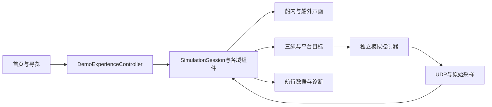

# 龙舟 Demo：启动、展示与功能接口

这份说明面向拿到项目后需要运行、展示或继续接入的人。桌面演示使用同一条软件闭环：独立控制器返回模拟桨状态，Unity计算水动力与船体运动，再发送三绳和平台目标并接收模拟反馈。船内、船外两视窗看到的是同一条船，机构在产品视窗中隐藏。

当前版本和软件验收范围见 [软件验收说明](软件全链路闭环验收.md)，本轮真实船桨接入见 [嵌入式交接手册](hardware/paddle/README.md)。三绳保真仍未通过；PICO、真实采样、电机、平台和人体体验有各自后续验收。运行数据页会区分模拟来源、请求命令和反馈命令。下文运行包操作需要完整本地 `Builds/DragonBoatVR`，Git 克隆不包含运行包。

## 1. 第一次运行

1. 在工作区双击[启动龙舟VR.cmd](启动龙舟VR.cmd)，进入展示首页。首页选择船型、河景、水况，再点击“开始体验”。
2. 需要展示现有CAD设计配置时，双击[启动CAD机构龙舟VR.cmd](启动CAD机构龙舟VR.cmd)。它使用同一个展示界面，额外选择未实测的CAD绳路及理想机械限位配置。
3. 对外拷贝整个`Builds/DragonBoatVR`文件夹，在其中双击“开始演示.cmd”或“CAD机构演示.cmd”。“演示说明.html”是离线使用说明。
4. 两个入口都会自动启动随包控制器，无须安装Unity、Python或另开mock发送器。不能只拷贝EXE；保留`DragonBoatVR_Data`、`UnityPlayer.dll`和其他随包文件。
5. 点“演示导览”按七步展示。窗口关闭按钮或Alt+F4退出程序；“结束体验”结束当前会话，之后还可以重新开始。

启动参数为`-presentation`，CAD入口另加`-cad-tendon-rig`。不带`-presentation`的内部夹具沿用自己的诊断界面。直接运行已有Unity场景不会自动创建展示界面；展示使用正式Player，源码开发仍可在编辑器中查看各组件。

## 2. 展示者怎样操作

| 入口 | 操作 | 可以观察到什么 |
|---|---|---|
| 首页／选船与水况 | 选经典木船或雕饰龙舟 | 船形、各自桨位与船舱空间；切船建立新会话，保留河景、水况与舒适选项 |
| 选船与水况／F2 | 两河景、平静／有风、水流速度和方向 | 环境、水面和船体响应；滑条调整水流，保持现有过渡行为 |
| 暂停划桨／F8 | 暂停，再恢复 | 暂停的是模拟划桨意图；波浪、船体物理继续，船可以惯性滑行 |
| 左侧船内视窗 | 右键转头，WASD或方向键移动，R回位 | 从船舱不同位置观察；视点受现有船舷、首尾和实体边界约束 |
| 右侧船外视窗 | 左键拖动环绕，滚轮调整距离 | 同一船体的整体运动、桨及水面；两视窗输入独立 |
| 航行数据／F1 | 显示或隐藏读数 | 当前航速、距离、桨频、冲量等同链统计 |
| 选船与水况／舒适模式 | 开启或关闭 | 现有周边视野收缩；这是可选显示功能，未外推为真人舒适度通过 |
| 操作说明／H | 查看移动方法与VR说明 | 头显追踪、实体空间与平台补偿的关系 |
| 操作说明→运行数据 | 查看六块数据及联调入口 | 原始采样、桨、水动力、三绳、平台和闭环状态 |
| 运行数据→完整诊断／F9 | 展开完整诊断，F9关闭 | 原有详细遥测、时效与来源；内部诊断供联调者使用 |
| 运行数据→原始采集CH1—CH4 | 打开原采集详情 | 通道读数、标定配置及有效性；这里仍是现有协议及采样工具 |
| 运行数据→输入模式 | 切到外部UDP，再恢复模拟桨 | 没有发送器时等待外部数据；“暂停划桨”按钮只控制模拟桨 |
| 结束体验／F10 | 结束 | 关闭当前闭环会话与控制器；不会把暂停划桨当作结束 |
| 重新开始／F11 | 重新定位并开始 | 建立新会话，重新统计航程，恢复划桨位和模拟输入 |

菜单和诊断打开时，桌面视点不接受移动输入。失焦时停止相机输入，原有仿真与UDP闭环继续运行。回放仍是内部诊断工具，不列为面向观众的产品功能。

### 建议的七步演示

| 顺序 | 展示动作 | 讲解重点 |
|---|---|---|
| 1 | 首页开始，设置中切换两船 | 两船共用现有等效物理基线，分别匹配视觉、桨位与舱内空间 |
| 2 | 切两河景、平静／有风，拖动水流 | 环境选择与水动力输入怎样影响船体，而非仅切换背景图片 |
| 3 | 看入水、推进和出水；暂停数秒再恢复 | 人的输入替身、实际模拟响应、推进与惯性滑行 |
| 4 | 舱内前后查看；船外环绕、缩放；R回位 | 两视窗关联同一船体，桌面视点移动不推动船体 |
| 5 | 持续运行，观察泡沫、水花、尾迹和水声；开启舒适模式 | 声画从运行中的运动和接触派生；头显与主观听感还须实机验证 |
| 6 | 打开运行数据与详细诊断 | 显示请求、模拟执行、反馈和下一次输入之间的关系；明确保真未通过 |
| 7 | 结束，再重新开始 | 会话、控制器、统计和视点的完整生命周期 |

导览面板提供“下一步”和对应操作按钮，可随时关闭、重新打开。展示过程中各功能仍由自己的域组件执行。

## 3. VR怎样同步人的移动

PICO 4 Ultra内置环境追踪摄像头和惯性传感器，头显系统据此提供头部的三维位置及三维朝向，即六自由度头部追踪。官方规格列出四颗环境追踪摄像头：[PICO规格](https://www.picoxr.com/global/products/pico4-ultra/specs)。不需要另装一个专门计数“走到船头”的传感器。

例如实体场地中，使用者从标定为船尾的位置向前走1米，头显报告头部平移；经过米制坐标、前向、原点与桨位标定后，虚拟视点相对船舱也向前移动。转头改变相机朝向，蹲下改变视点高度。头显追踪的是头部，不能据此直接声称已测得脚的位置、全身姿态或真人重心。

必须区分三种运动：

| 运动 | 数据来源 | 对画面的作用 |
|---|---|---|
| 人在实体体验空间里移动、转头 | PICO头部追踪 | 更新相对于实体平台／船舱的头部位姿 |
| 六自由度平台本身平移、倾斜 | 实际平台位姿观测，配准到同一追踪坐标系 | 从头部观测中扣除实体平台运动，再叠加虚拟船体运动 |
| 坐在小平台上浏览更远的虚拟船舱 | 另设手柄导航等虚拟位移输入 | 增加虚拟移动偏移；不属于已经实际走到该位置 |

所以，真的走船尾到船头要有相应实体活动空间；小平台上的人不会因为头显存在而能走出平台。当前桌面WASD是虚拟浏览入口，后续VR导航方式仍要按最终体验布局选定。桨的姿态、绳长和受力继续由桨传感器及执行反馈取得。

平台补偿解决的是重复运动：平台带着人倾斜时，头显也会测到这次倾斜；若再把虚拟船的倾斜完整叠上，画面会多转一次。当前软件准备的组合关系为：

```text
世界中的视点 = 虚拟船位姿 × 实体平台位姿的逆 × 头部追踪位姿
```

头部和平台位姿必须使用同一个已标定的追踪坐标系，并保留各自观测时间。平台目标命令不能当作实际平台观测。当前程序已经有对应适配、独立时效检查和逐眼渲染准备，但尚未安装PICO XR插件、完成场景接线或通过头显实机验收。头显按 [PICO接入手册](VR头显接入手册-Pico4Ultra.md) 继续；三绳采集、驱动和电脑适配按 [船桨交接手册](hardware/paddle/README.md) 继续。

## 4. 面向后续开发的统一操作接口

入口类为[DemoExperienceController.cs](DragonBoatVR/Assets/Scripts/DemoExperienceController.cs)，命名空间`DragonBoatVR`。展示启动时创建一次，跨场景保留；切船后重新绑定已有域组件。后续界面可使用同一组命令，不必各自改写仿真逻辑。

| 接口 | 输入／返回 | 行为与前提 |
|---|---|---|
| `Ready`／`CanConfigure` | 只读bool | 场景与组件准备完毕；配置操作另排除切船、录制和回放中的冲突 |
| `ExperienceActive`／`Paddling` | 只读bool | 当前体验状态与模拟划桨意图状态 |
| `BeginExperience()` | bool | 通过原结束／重新定位流程建立新会话，不创建第二个控制器 |
| `EndExperience()` | bool | 委托`SimulationSession.EndExperience` |
| `RepositionExperience()` | bool | 委托原重新定位流程，遵守其当前状态条件 |
| `SelectBoat(id)` | `majesty`或`ornament`，bool | 返回是否接受切换请求；切换完成再等`SceneReady`／`Ready`，不能立即使用旧场景引用 |
| `SelectRiver(scene)` | `RiverEnvironmentController.SceneProfile`，bool | 选择`XiangjiangOrangeIsland`或`ShundeFengjian` |
| `SelectWater(condition)` | `WaterCondition`，bool | 选择`Calm`或`Windy` |
| `SetCurrent(speedMps, headingDegrees)` | m/s、度，bool | 拒绝非有限值，经现有环境控制器应用范围与过渡 |
| `SetPaddling(enabled)` | bool→bool | 只控制正在运行的`VirtualPaddler`；恢复45spm，与原F8相同 |
| `SetComfort(enabled)` | bool→void | 调用已有`ComfortVignette`用户选项 |
| `ResetSeatView()` | bool | 重置桌面视点；启用实测头部追踪时拒绝桌面回位，应走实测配准流程 |
| `SetMetricsVisible(visible)` | bool→void | 控制航行读数 |
| `SetDiagnosticsVisible(visible)` | bool→void | 控制原完整诊断，开启时展开详情 |
| `ShowAcquisitionDetails()` | void | 打开已有原始采集详情 |
| `CycleInputMode()` | void | 调用原HUD输入切换；外部UDP需要对应发送器 |
| `LoadRawAcquisitionProfile(path)` | 路径→bool | 调用原配置读取与验证；不凭载入成功宣称实物标定完成 |
| `ObservedFrame` | `SimulationFrame`或null | 返回最近一次完整帧的独立副本；无观测／时间线重置后为null |
| `Status` | string或null | 最近命令的拒绝原因，可显示给调用者 |
| `ActionInvoked` | `Action<string,string>` | 用户命令通知，拒绝附`[REFUSED]`；不能当作设备执行完成回执 |
| `SceneReady` | `Action` | 场景组件重新绑定完毕通知，不能代替控制器回包就绪检查 |

例如，在场景就绪后设置水况并开始：

```csharp
using DragonBoatVR;

var demo = DemoExperienceController.Instance;
if (demo != null && demo.CanConfigure)
{
    demo.SelectWater(RiverEnvironmentController.WaterCondition.Windy);
    demo.SetCurrent(0.08f, 0f);
    if (!demo.BeginExperience())
        UnityEngine.Debug.LogWarning(demo.Status);
}
```

界面类[DemoPresentationUi.cs](DragonBoatVR/Assets/Scripts/DemoPresentationUi.cs)提供`SetPage(Page)`、`ToggleSettings()`和`StartGuide()`。它负责布局、选项状态、提示与导览；水动力、设备时效和会话推进仍由原组件负责。

## 5. 各域的接入边界



| 域 | 当前接口／负责人 | 后续接实物时的边界 |
|---|---|---|
| 模拟桨与真实采样 | `PaddleDriver`、`HardwareUdpBridge`、原始采集配置 | 取得真实帧格式、通道映射、单位、坐标和时间；保留真实来源，经过现有解码及有效性检查 |
| 水动力与船体 | `PaddleHydrodynamics`、`BoatBuoyancy`、`SimulationSession` | 使用实际桨状态；水阻实验提供独立数据，不用UI伪造受力或直接推进船 |
| 三绳 | `IForceFeedbackDevice.Receive(ForceFeedbackRequest, dt)`与`Feedback` | 请求含序列、来源输入序列、世界合力及握点力矩；实际绳路、正张力能力、执行与回执须另外确认 |
| 平台 | `IPlatformMotionDevice.Receive(PlatformMotionRequest, dt)`与`Feedback` | 请求和实际反馈分别保留；实机接口及平台位姿观测另接入，目标不能代替反馈 |
| PICO头部 | `UnityXrHeadTrackingProvider`／`HeadPoseAttachment` | 启用匹配XR运行时；读取有效头部位置、朝向，处理追踪原点变化；当前通用API无设备采集时间戳，记录本地观测时间 |
| 平台追踪补偿 | `SubmitPlatformObservation`／`SubmitIndependentTrackingSample` | 头部／平台在同一实测配准坐标系，独立时间；头部更新不能刷新旧平台观测年龄 |
| 运行观测 | `SimulationSession.FrameCompleted`、`TimelineReset`与展示`ObservedFrame` | 读完整同链帧；保留`simulated`、`valid`、请求／回执序列及残差 |

具体DTO在[SimulationContracts.cs](DragonBoatVR/Assets/Scripts/SimulationContracts.cs)，`SimulationFrame`定义在[SimulationSession.cs](DragonBoatVR/Assets/Scripts/SimulationSession.cs)。反馈请求在`frame.feedbackRequests`中。各域现有计算与传输看 [数据流规格](资料汇总/数据流全链路规格.md)；真实三绳输入、目标分配、反馈和生命周期停机的实现责任看 [船桨交接手册](hardware/paddle/README.md#电脑端适配必须完成的工作)。

## 6. 跑不起来时先看哪里

| 现象 | 具体处理 |
|---|---|
| 双击提示缺EXE | 核对`Builds/DragonBoatVR`完整包是否在原位置；Git源码仓库不含生成的构建包 |
| 打开旧菜单，没有展示首页 | 使用本轮两个启动脚本或随包“开始演示.cmd”，确认命令含`-presentation` |
| 等待控制器／桨不动 | 确认随包`controller_runtime`完整；查看运行数据的来源、有效性和过期状态 |
| 外部UDP模式没有输入 | 在运行数据页恢复模拟桨；只有联调外部输入时才需要自己的发送器 |
| WASD不移动 | 关闭菜单／诊断，鼠标放回左视窗；右窗使用自己的拖动操作 |
| 结束后不再划桨 | 点击“重新开始”或F11；F8暂停／恢复用于当前活动会话 |
| 想在PICO里立即展示 | 桌面包不等于已验PICO应用；先按手册完成XR、实测配准和平台观测接线 |

正常运行日志在`%USERPROFILE%\AppData\LocalLow\DefaultCompany\DragonBoatVR\Player.log`；显式`-logFile`启动时使用指定路径。联调记录应保留构建版本、所选输入和CAD／默认配置，避免把不同配置或旧包状态混在一起。
