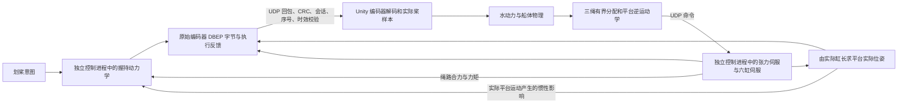

# 软件全链路闭环与交付验收（2026-10-31 入口对齐）

> 当前范围：本地电脑、单人，脚本替代人的划桨输入，各模块输入、输出、作用和反馈贯通；内部允许标注的简化模型与固定数据。最终实机的桨运动由人划桨决定，可达范围由硬件限位保证；电脑理想限位仍属未实测假设。三绳保真、主观听感和硬件/Pico 验收单独保留。
>
> **最新范围、正式/候选版本、分工和验收状态只在[当前执行交接](tmp/closed_loop_20261025/IMPLEMENTATION_STATUS.md)维护。** 本文件保留闭环结构与原始验收依据；后文旧包、分工及“当前”描述均指相应历史时点，不据此等待旧进程或重复运行。用户已将岸边岸上工作移出当前队列，旧视觉 FAIL 保留；HUD 发布与本轮 CAD/反馈修复、双船补验、`053308` 正式发布均已完成，具体原始证据与复用范围见当前执行交接。精确人体握持调参、无机构约束穿船扫测和重复长时观察不再是本期前置流程。已发布的 `180927` 历史依据见[发布清单](_archive_20261030/publication_20261030T183544/publication.json)，不能将其原始源/包快照改写为后续版本的实测。

## 180927 已归档证据

- [本轮软件基线](tmp/final_validation_20261030/20261030T093147Z_checks/audit.json) 13/13、runtime 19/19、paddle 14/14；[九项专项](tmp/final_validation_20261030/20261030T100407Z_targeted/audit.json)全部通过，包含两船远山/外岸真实接触、整船取景及实际 GPU 水面穿舱对照。40 份用户确认正常的划桨相关文件逐一不变。
- [双船真实操作](tools/desktop_input_checks/20261030T101401.604954Z_experience_choices/experience_verification.json) 28/28；[同包 Player 验收](tmp/final_validation_20261030/20261030T102341Z_player_checks/audit.json)包括 180 秒自然转向/近岸环绕 20/20、船舱 30/30、四环境、失焦/350 ms 暂停及木质接触，全部 PASS。独立实际桨网格三轮累计 14022 个记录姿态零相交，实际 OBJ 整船取景通过；[107 张实图审阅](tmp/final_validation_20261030/visual_review_180927.json)通过。采样与软件通过不代表全部渲染帧、完整连续扫掠或真实手感验收。
- **普通正式包连续观察已结束。** [原运行结果](tools/desktop_input_checks/20261030T110556.729379Z_published_observation/observation_result.json)记录 1853.641 秒观察、0.243932 秒正常退出、单控制器及自有进程全部退出，源/包不变，运行器判定 PASS；[同轮 33 张实图复核](tools/desktop_input_checks/20261030T110556.729379Z_published_observation/visual_review.json)在最后四张发现船尾被裁，视觉结论为 FAIL。两种结论分别保留，不能将运行 PASS 当作视觉或整体验收通过。旧 5480 及 19:36:56 截止时间已失效；当前任务服从顶部的最新用户范围，不据此重新开启岸景维修或半小时观察。

## 102418 历史证据

- [最终软件基线](tmp/final_validation_20261030/20261030T022105Z_checks/audit.json)为 13/13、runtime 19/19、paddle 14/14；[八项专项](tmp/final_validation_20261030/20261030T021615Z_targeted/audit.json)包含两船实际 GPU 穿舱对照及原波浪同源检查，全部通过。水面修复只裁剪船内水面显示，没有改波浪、浮力或力反馈。
- [双船真实操作](tools/desktop_input_checks/20261030T022828.994162Z_experience_choices/experience_verification.json)28/28、2437 个实际桨姿态零相交、2471 个投影及整船取景 PASS；[同包 Player 检查](tmp/final_validation_20261030/20261030T023204Z_player_checks/audit.json)包含转向/近岸、船舱、四环境、失焦/暂停和木质接触，全部完成。[107 张实图复核](tmp/final_validation_20261030/visual_review_102418.json)通过，四环境原始 729 张记录另已核验来源和时序。
- **普通连续观察已结束，综合画面验收 FAIL。** [原观察结果](tools/desktop_input_checks/20261030T044527.889856Z_published_observation/observation_result.json)实际观察 1913.275 秒，65 个进程样本、34 张实图、单控制器；0.255795 秒正常退出，全部自有子进程退出，源/包及发布依据 SHA 一致，原 15 秒上限未改。原观察器进程/退出 PASS 保留；[全部 34 张实图复核](tmp/final_validation_20261030/102418_ordinary_review/review.json)在第 24 分钟发现岸坡遮住舱内视角及船外大半船体，终验不能通过。当前继续定位和维修，新修复需按新源/包验收；昨晚未完成的观察仍不追认。
- 三绳 FIDELITY FAIL、硬件/PICO、真人手感和舒适度、主观听感及长期硬实时边界继续保留。

## 214841 历史证据

- 发布前的[同包验收](tmp/final_validation_20261029/20261029T135257Z_player_checks/audit.json)已完成近岸真实环绕 20/20、独立 OBJ 取景比对、33 动作船舱 30/30、四环境连续音画、失焦/350 ms 暂停和木质接触。此前“请求能装下整船，平滑后反而裁船”的实际反例已纳入 151 项相机检查；原失败未覆盖。
- 本日另一测试会话新跑的[全量基线](tools/check_results/20261029T165411.053004Z_373bfaef/results.json) 13/13、[runtime](tools/runtime_checks/20261029T165715.574552Z_8e19c03b/verification.json) 19/19、[paddle](tools/paddle_demo/20261029T165845Z_040e138b/verification.json) 14/14 均 PASS，接续 root 已读取原始结果。
- [正式目录四环境闭环](tools/closed_loop_checks/20261029T165937.515068Z_27b7bd4a/verification.json)的内部 14 项及原始协议、反馈、四种河景/水况核验 PASS，源/包未变；[正式目录失焦检查](tools/closed_loop_checks/20261029T170525.513538Z_80cc4f8e/verification.json)另确认失焦期间 119 个新鲜物理帧、85 个不同反馈序号并恢复。
- 214841 当时至 23:00 的持续观察未完成，不追认；当前普通正式包的观察进度见上方 102418 条目。三绳 FIDELITY、主观听感、硬件/Pico、未实测标定与长期硬实时边界继续保留；软件局部 PASS 不代表这些已通过。

## 2026-10-29 07:45 历史合并验收

相机线程已于 06:11 完成上一轮新视角交接，维修线程随后完成正式发布。新增取景缺陷出现后，维修线程已于 **07:15:49 交回排他运行窗口**，当前由相机线程修复并复验。062636 和 055504 的 **200 个运行文件字节一致**；上次发布仅修正两个 Python 验收工具并刷新构建清单，保留原隔离控制器运行时。原包完整归档，版本对账见 [package_refresh.json](_archive_20261029/motion_stage_alignment_062207/package_refresh.json)。下列已完成检查保留原覆盖范围，不能代替新增转向取景检查。

| 检查 | 已实际验证的结果 | 原始证据 |
|---|---|---|
| 完整基线 | 13/13 PASS，独立三绳 FIDELITY 仍 FAIL | [结果](tools/check_results/20261028T220929.668111Z_fbdfca7d/results.json) |
| 正常 Unity 循环、输入时效、采集与诊断 | 19/19 PASS | [运行检查](tools/runtime_checks/20261028T221206.211593Z_63c05a77/verification.json) |
| 桨动作、稀疏 UDP、失效与体验控制 | 14/14 PASS，近景入水/出水/尾流实图已看 | [划桨检查](tools/paddle_demo/20261028T221330Z_9ae59e75/verification.json) |
| 相机专项 | 13/13 PASS，原 0.18 m 舷边留量与实体阻挡保留 | [专项](tools/targeted_checks/20261029T055200_b60ddd5b/results.json) |
| 真实键鼠与双视窗 | 24/24 PASS，33 动作、2271 样本、34 图，实际通行 7.138 m、连续转头 420 度 | [相机核验](tools/desktop_input_checks/20261028T215825.066251Z_cabin_controls/verification.json) |
| 真实操作者快捷键与菜单入口 | 18/18 PASS，20 动作、1542 样本、21 图，实际控制进程启停及水况变化均对上 | [操作者核验](tools/desktop_input_checks/20261028T220809.710496Z_operator_controls/operator_verification.json) |
| 四环境、断连恢复与连续音画 | 062636 同包内部 14 项及独立核验 PASS | [结果](tools/closed_loop_checks/20261028T223108.897883Z_53414e1f/verification.json) |
| 同包失焦/350 ms 暂停及木质接触 | 两项完整 PASS，3275 个实际桨姿态无网格交点 | [暂停](tools/closed_loop_checks/20261028T223529.906661Z_1df90f6f/verification.json)、[接触](tools/wood_contact_checks/20261028T223638.684359Z_16570422/verification.json) |

实际 F8 暂停/恢复划桨为 45→0→45 次/分，控制进程与仿真继续；F4 切换输入使旧控制器退出，返回脚本后产生新 PID 和会话。F10/F11 及菜单结束/重启均实际启停自己的控制进程并复位仿真。河景、平静/有风、水流速度/方向按钮改变了实际场景、波强和水流向量；F1 显示/隐藏已看实图。相机菜单阻挡、转头、首尾与两侧边界、失焦/Esc 释放、R/F11 复位和左右窗输入隔离已通过，始终只有两个产品视窗。

## 本轮保留的失败与修复

四环境运行 [221421 原始 FAIL](tools/closed_loop_checks/20261028T221421.588172Z_88337484/verification.json) 内部 14 项及原始控制/环境证据通过，但图片来源核验误报 1 张图。测试阶段在 Update 中从 Normal 切为 Disconnected，下一次物理步尚未完成；该图和实际双相机仍对应最近完成的物理样本，物理时间、反馈 2201、相位及姿态全部一致。核验器原先以“阶段+物理时间”查找来源，错误地把阶段名称当作物理身份。

现在按实际相机之前最近完成的物理样本核对，并在停止/重启时清除旧来源；图片阶段仍需与实际相机一致，精确物理时间、反馈身份、相位及 **0.0001 m / 0.05 度**门槛保留。新增回归先在旧实现复现阶段误报，以及旧样本、未来样本和重启前样本被误接的问题；修复后相关 Python 检查 **103/103 PASS**。

原始 730 张图和 24549 条记录未改，[修正核验器后的重新核验](tools/closed_loop_checks/20261028T221421.588172Z_88337484/motion_reverification_after_stage_fix.json) 对上 702 张有效图，28 张失效/启动图如实保留。该轮 [实际桨网格审计](tools/closed_loop_checks/20261028T221421.588172Z_88337484/paddle_mesh_audit.json) 有 2479 个姿态，桨杆与桨叶边缘交点均为 0。原 verification FAIL 保留；随后最终候选已完成全部必需检查并发布，见下一节。

历史 033152 副相机反射异常、041629 菜单实际开启却未阻挡移动、默认朝向船舱仅走通 2.45 m，以及两次切向修复专项失败全部保留。它们不计入当前通过结果。相机修复与完整功能证据见 [功能交接](tmp/desktop_views_20261029/STATUS.md)。

三绳固定基线平均/峰值残差仍为 **28.14/143.52 N，FIDELITY=FAIL**。100 ms TTL、身份/新鲜度与机构限制不变。实机、Pico 4 Ultra、主观听感和长期硬实时保证均未冒充完成；细化的执行状态见 [当前交接](tmp/closed_loop_20261025/IMPLEMENTATION_STATUS.md)。


## 正式发布与后续持续观察

[正式 Windows 包](Builds/DragonBoatVR/DragonBoatVR.exe)已于 06:44 更新为 062636。[发布记录](_archive_20261029/publication_20261029T064253/publication.json)包含 201 个交付文件、旧主包归档、所有门禁和源码版本关系；[正式路径检查](tools/closed_loop_checks/20261028T224534.263826Z_1777da2e/verification.json)另有 14 项及独立核验 PASS，确认实际启动随包隔离控制器。

最终四环境有 23439 条完整原始记录、3723 个物理帧、728 张图片，其中 698 张有效图逐张对上双相机和最近完成的物理样本。37.781 秒混音无削波，双视窗各有 8642 次正常有效展示。失焦区间仍有 120 个新鲜物理帧和 92 个回包序号；实际暂停 350.516 ms 后，独立看门狗撤销两路执行授权，恢复后有 314 个新鲜帧。木质接触包括 1100 帧和 523 块碰撞体，三类接触各发声一次、分离不重复。两次[四环境网格审计](tools/closed_loop_checks/20261028T223108.897883Z_53414e1f/paddle_mesh_audit.json)与[暂停网格审计](tools/closed_loop_checks/20261028T223529.906661Z_1df90f6f/paddle_mesh_audit.json)合计 **3275 个实际显示桨姿态、0 个桨杆/桨叶边缘交点**。

追加[重复生命周期核验](tools/desktop_input_checks/20261028T224832.471341Z_lifecycle_cycles/lifecycle_reverification.json)为 **45/45 PASS**：38 次真实按键、2275 条观测、39 张实图，22 个控制器进程和会话依次建立，结束后均无残留；连续两次结束后仍能正常重启。最初离线分析因动作名字后缀误归类的 FAIL 原样保留，更正为实际按键和前态后重新核验。

首段[持续运行记录](tools/desktop_input_checks/20261028T225841.288826Z_sustained_runtime/sustained_runtime_result.json)为 **PARTIAL**，[独立核验](tools/desktop_input_checks/20261028T225841.288826Z_sustained_runtime/independent_observation_review.json)为 **FAIL（第三人称取景）**：船持续转向后，scene_0001/0002/0003 的船头或船尾出画。观察已于约 07:15 安全结束，共 977.945 秒、33 次资源采样、6 张原图，所有自有进程退出，源/包及原始记录 SHA 未变。等待相机修复的新候选交回后继续核验和观察至 23:00。定期资源和画面观察不记录每个数据包，不能替代逐包时效或硬实时验收。

062636 正常段桨位误差均/峰 0.175/0.437 m、原始水动力峰 130.40 N，见[描述性模型响应](tools/closed_loop_checks/20261028T223108.897883Z_53414e1f/response_summary.json)；这些不是手感保真达标声明。

## 现在闭合了什么

默认体验使用独立的本机 UDP 控制进程。脚本只提供希望完成的划桨轨迹，实际桨位置与朝向由电机张力、绳路、握持弹簧/阻尼/惯量和平台执行状态共同决定。实际位置重新变成原始编码器包，经 UDP 返回 Unity 解码，参与下一步水动力、船体运动和新的执行命令。



- 两个进程使用不同 PID、独立时钟和真实 UDP socket。DBCL 包携带会话标识、序号、长度和 CRC；内层 52 字节 DBEP 也在控制进程生成。Unity 直接解码收到的原包，不再本地重造该包。
- 实际张力、绳长、平台缸长和平台位姿来自收到的反馈。物理输入只在输入边界读取一次反馈，避免同一帧混入不同观测。
- 同一意图下，改变电机负载或电机/平台响应时间，会改变后续原始编码器读数。相应对照由独立机械测试验证。
- 输入和反馈的有效期仍为 100 ms。超时后主链输入失效、请求归零；实际张力按伺服模型衰减，平台保持实际缸长，衰减过程如实回报。不能把有残余张力的执行器报告成瞬时无力。
- 停止体验会关闭自己的控制进程；重新定位启动新进程和新会话并清除旧解码状态。离开脚本划桨模式也会停止旧控制器，返回时重新建立会话。
- 控制器缺失、启动失败、配置错误、运行中机构几何变更或进程退出均使动态输入失效，并提供明确状态。

## 修复和模型范围

| 问题 | 处理 |
|---|---|
| SensorMounting 输入超出锁定包络 | 将测试轨迹放回合法工作空间；安装转换精度标准不变，越界另测 |
| UDP 位置裁剪后仍保留向外速度 | 用已接受的有界位姿求导，裁去越界轴的向外速度；保留切向、角速度与船体点速度 |
| 解码失败仍可能传递有效样本 | 拒绝时明确失效并清零导数，不再把旧有效标记传入水动力 |
| 平台模型拒绝后仍可能发出有效请求 | 拒绝同时撤销请求有效性，外设适配器再次检查本地接受状态 |
| 桨编码器 Missing Script | 修正场景脚本 GUID，运行验收把 Missing Script 作为失败 |
| 三绳近对向分配收敛不足 | 三根以内枚举有界最小二乘活动集并检查 KKT；保留预紧、张力上下界及不可达残差 |
| 六缸示例均匀环形布局退化 | 默认配置采用三对铰点假设布局，保留 0.8/0.55 m 半径、0.6 m 高度及原行程限位 |
| 反射相机首次运行报错 | 相机跟随完成后渲染；处理相机落在裁剪平面的奇异投影，正确设置 RT 全视口 |
| 证据写入与关闭时序 | 异步排空后确认 sink 已关闭、完整行数和 SHA256；未完成写入不算通过 |

三绳专项中，近对向解析案例的残差从旧 160 轮求解的 0.984177 降到 2.235×10⁻⁸。但机构基准仍为 **FIDELITY=FAIL**：2026-10-29 本轮完整基线的平均力残差 **28.14 N**、峰值 **143.52 N**，见[本轮基线](tools/check_results/20261028T220929.668111Z_fbdfca7d/results.json)。[2026-10-28 早期基线](tools/check_results/20261027T182002.815800Z_90042eb9/results.json)的 22.94/112.17 N，以及更早的 25.70/111.69 N 和 30.08/104.32 N，均属历史版本。三根只能拉的绳不能任意实现六维力与力矩，数值最优不是手感还原成功。

配对平台的中位雅可比秩为 6；729 个范围采样姿态均满秩，其中 669 个满足原缸长范围，60 个被行程限制拒绝。这里不是连续工作空间的可达性证明，未验证铰链角度、碰撞、承载和真实驱动稳定性。

电机响应、握持阻抗、传感器分辨率和平台几何仍是明确标注的未实测模型。2026-10-25 续修后，平台实际正运动学位姿产生平移和转动速度、加速度，握持模型包含移动坐标系中的欧拉、离心、科里奥利与角速度坐标变换项；平台保持时的制动也进入模型。没有把全部人体生物力学、机构柔性、摩擦、背隙或硬件固件实现声明为已仿真。

还需明确的仿真层边界：当前六路编码计数由桨的位置与欧拉角直接量化，并非已确认实物传感器拓扑的完整测量过程；电机和电缸采用一阶响应及速度/幅值限制。动态验收的受载检查证明执行力与后续运动发生关联，没有把轨迹误差或力残差的保真上限作为通过条件。因此，链路通过不能推出这些模型的完整性或效果达标。普通 Player 渲染通过也没有验收完整的头部追踪与立体显示链。

本期边界同时服从《项目现状核查与执行交接方案》：保留三绳、六缸近似模型，不要求真实传感器精度、真实头显体验或真实电机输出。ADC 仍按已声明的观测通道处理，不能在没有功能映射依据时接入力或姿态计算。完整人体生物力学和电机电路并不是为了获得“软件闭环通过”而临时新增的要求；但现有假设模型的自洽性、真实数据消费和能力残差必须验证。

## 续修：采样、几何、显示和恢复的一致性

1. **实际姿态显示**：独立反馈拥有桨的姿态时，`Tick` 和 `LateUpdate` 不再用理想划桨轨迹覆盖它。渲染使用最后接受的船体局部实际姿态，跟随船体插值；失效保持实际姿态，重置或切换模式立即撤销旧缓存。运行验收在实际相机渲染完成后记录姿态，再与原始编码器对应的物理样本比较。
2. **采样时间**：`controllerTimeSeconds = plantSampleTick × 0.005`，只表示实际积分时间。`controllerWallTimeSeconds` 与丢弃的调度步另行报告。新命令先让旧命令完成已到期的历史步，再生效；不能把新力追溯施加到过去。原来的 100 ms 接收和确认时效继续使用墙钟。桨速依据不同编码观测的积分采样时间计算。
3. **同一观测几何**：三绳分配使用输入时刻的船、桨快照，水动力向量转回局部坐标时也使用该时刻的旋转。船体完成物理步后的新姿态不会混入旧请求的绳路矩阵。
4. **恢复连续性**：失去执行反馈或停止发送命令时，模拟划桨者暂停意图相位；恢复后接着推进。控制器实际位置、速度和惯性不会重置。相位以及目标线/角速度均按不同原始观测的 `controllerTimeSeconds` 间隔计算；同一观测被重复消费时保持意图。首次、恢复或超过 100 ms 的采样空档只建立基线，不追赶推进。不能使用 Unity 补帧调用间隔或其标称固定步替代控制器采样时钟。
5. **方程检验**：解析测试分别检查惯性各项、共同刚体旋转不变性、平台制动、无外力时能量衰减、正弦响应的步长收敛和静态力矩平衡。现有角刚度为 30 Nm/rad，恒定 10 Nm 外矩的平衡偏转应为约 19.10°；“杆端误差必须只有几厘米”不是该参数模型本来具备的性质，不能通过改验收数字伪造。

这些修复验证的是当前声明的模型和数据链自洽。原三绳几何的可实现力域仍不满足任意六维目标。独立重算旧 Player 的 384 个受载观测时，即使求得当前约束下的最优张力，没有一个达到原 95% 六维还原标准；最大最优张力约 129.25 N，远低于 300 N 上限，说明单纯增大张力上限不能补齐方向缺口。重算与详细依据见 [三绳独立审计](tmp/tendon_player_audit_996152e6/report.md)。

把保真要求继续推进到机构层，需要实际出绳点、三根绳的独立电机映射、桨上系绳点、握把和桨叶几何，以及允许改变哪些安装位置。得到这些数据后才能重新计算实际可达力域；若方向缺口仍在，就必须调整机构或限定可还原动作，软件求解器不能凭空产生只能推不能拉的绳力。当前假设坐标不应被包装成已经测量的机构参数。

## 运行与复验

完整交付目录为 `Builds/DragonBoatVR`，入口是其中的 `DragonBoatVR.exe`；请保留同目录的 `_Data`、`MonoBleedingEdge` 等依赖。交付流程把本机 CPython 标准库及许可复制到隔离运行目录，不下载软件，也不包含第三方 site-packages 或用户配置。Player 默认优先使用这个随包解释器；Editor 使用本机 Python。

在 `F:\vr视觉` 执行，Unity 运行器会排他占用项目：

```powershell
python.exe -B tools/run_targeted_checks.py input platform feedback solver loop
python.exe -B tools/run_targeted_checks.py observation render height reflection
python.exe -B tools/run_all_checks.py
python.exe -B tools/run_runtime_check.py
python.exe -B tools/run_paddle_demo.py
python.exe -B tools/run_closed_loop_check.py
python.exe -B tools/build_closed_loop_player.py
python.exe -B tools/run_closed_loop_check.py --player Builds/DragonBoatVR/DragonBoatVR.exe
python.exe -B tools/run_closed_loop_check.py --player Builds/DragonBoatVR/DragonBoatVR.exe --background-check --host-stall-check
```

原 19 项运行检查和 14 项桨动作检查显式采用 `-kinematic-fixture`，保留给定输入的解析验证。默认动态产品链路另由 `run_closed_loop_check.py` 验证；不能用前两项代替它。

新增动态验收观察普通 Unity PlayerLoop：至少 3 次实际入水、独立进程与原始编码器、反馈消费、受载运动、平台正运动学、断线、恢复、停止、新会话重启、正常渲染和证据完成。Python 从原始包独立重算，而不只相信 C# 的通过标记。Player 验收移除外部 Python 路径和环境配置，检查控制进程实际解释器路径及整个交付目录前后哈希。

## 首次交付记录（续修前基线）

下列是续修前第一次交付的记录，不代表本文新增修复已在该旧 Player 中验证。各项保留独立原始日志、JSON 和截图，不能将统计总分解释为实机或手感保真通过。

| 验收 | 本轮结果 | 证据 |
|---|---|---|
| 原 13 项基线 | 13/13 PASS | [results.json](tools/check_results/20261025T105918.164770Z_3d7f0e06/results.json) |
| 普通运行解析与协议检查 | 19/19 PASS | [verification.json](tools/runtime_checks/20261025T110613.365123Z_fcfaed75/verification.json) |
| 桨动作与 SensorMounting | 14/14 PASS，原容差保留 | [verification.json](tools/paddle_demo/20261025T115254Z_88794cda/verification.json) |
| 输入/平台拒绝/反馈消费专项 | 7/7、6/6、4/4 PASS | [results.json](tools/targeted_checks/20261025T161816_9b4e951c/results.json) |
| 三绳最优性 | 7/7 PASS；手感保真另判 FAIL | [solver.log](tools/targeted_checks/20261025T184818_36ea7ec2/solver.log) |
| 控制器启动、模式、过期、配置边界 | 4/4 PASS | [loop.log](tools/targeted_checks/20261025T185420_d700c4e6/loop.log) |
| 默认动态闭环 Editor | 9/9 + 独立原包复核 PASS | [verification.json](tools/closed_loop_checks/20261025T115655.511736Z_6e8cd8b9/verification.json) |
| Player 构建 | Succeeded，0 errors；已附隔离运行时 | [build.log](tools/build_results/20261025T204025/build.log) |
| 实际交付 Player | 9/9 + 独立原包/整目录哈希/运行时路径复核 PASS | [verification.json](tools/closed_loop_checks/20261025T125246.088811Z_996152e6/verification.json) |

Python 控制器专项 14/14 通过，包含实际子进程 UDP 与内层 DBEP 校验、watchdog、父进程退出、响应速度对照及配对平台；证据见 [控制器测试日志](tmp/input_physics_python_review/closed_loop_controller_dbep_packet.log)。独立验收器 14/14 离线测试通过，覆盖错误成功标记、过期仍有效、停止后出力、损坏包、黑图及错误运行时等反例；可在 `tools` 目录执行 `python.exe -B -m unittest test_closed_loop_verifier -v`。

交付 Player 这次观测到 **1327 帧、6 次正常阶段实际入水、1226 帧有效原始编码器反馈**；1383/1383 条证据完整写入。62 帧超时观测无失效保护违规，收到实际张力衰减后的零值回包；停止和重新定位建立新的 PID 与会话。实际平台缸长与正运动学的最大拟合残差约 **0.0000984 mm**。输入身份、过期、停止违规均为 0。进程退出后没有遗留本次 Unity/Player/控制器进程。

正常阶段实际桨与意图位置偏差均值 **0.166 m**、峰值 **0.575 m**；原始未平滑水动力有 **1825 N** 尖峰，已记录，不能当作设备应直接输出的力。对应执行反馈的力残差均值 **11.26 N**、峰值 **65.89 N**。这些数值描述当前假设模型的响应，不是已标定的人体手感或硬件跟踪精度。断线恢复阶段的较大偏差也保留在原始证据中。

失败记录没有删除：最初桨动作运行被仍可操作的水况面板切到“有风”，截图证实静水前提被破坏；现已在诊断 fixture 中隔离该操作并逐帧检查静水前提。首次 Player 批处理运行虽有相机回调，截图却为黑图，因此判为失败；随后验收使用正常窗口呈现，且通过 PNG 完整性、非空及人工查看。[首次交付 Player 截图](tools/closed_loop_checks/20261025T125246.088811Z_996152e6/normal_closed_loop.png)。

仍需未来硬件阶段完成：实测机构/传感器标定、真实 UDP 固件与设备驱动适配、摩擦/背隙/负载响应辨识、三绳可实现力域与手感评估、平台限位/碰撞/承载以及 Pico 4 Ultra 的追踪与显示延迟。此处没有把这些项目计入软件 PASS。

## 2026-10-26 续修后记录

这次补齐了实际桨姿态显示、统一采样几何、控制器积分时间、平台惯性耦合和连续恢复。相机渲染证据现在只接受真正输出到屏幕的相机；左右视窗分别需要有天空、同帧且属于各自相机的水面反射。早先把离屏反射回调也计入的 9/11 项记录不能替代这项新门禁。

人工复核发现第三人称相机沿用纯色背景、两个视窗共用第一人称反射图；已修正场景及初始化脚本，并为每台相机缓存独立反射资源，修正镜像视图的左右手性、投影与状态恢复。一个河流配置资产的 GUID 原为 33 位，已改为无冲突的 32 位；其余 245 个元数据 GUID 格式正确且无重复。

用户随后明确要求“远水不要过于平整镜面，保留近处”。当前实现从 5 到 22 米连续引入较宽的实拍法线波纹、模糊反射并温和降低完整倒影权重；几何波谱、水动力和现有近水参数未改。同机位、同时间的 [调整前](tools/water_previews/20261026_distant_v3/before.png) / [调整后](tools/water_previews/20261026_distant_v3/after.png) 显示远处轮廓被波纹打散。两个近水选定区域逐像素差为 0，范围与统计见 [comparison.json](tools/water_previews/20261026_distant_v3/comparison.json)。这不是全画面或所有机位完全不变的保证。

| 检查 | 已验证结果 | 证据 |
|---|---|---|
| 核心编排修复后的完整基线 | 13/13 PASS | [results.json](tools/check_results/20261025T144620.992993Z_3247bf9a/results.json) |
| 同一观测几何 / 实际姿态与重置 / 输入时钟边界 | 4/4、5/5、5/5 PASS | [几何](tools/targeted_checks/20261025T220814_035d9cb5/results.json)、[姿态及边界](tools/targeted_checks/20261025T223205_953f77d6/results.json) |
| 波高优化等价性 | 90,000 点，最大差 0 | [results.json](tools/targeted_checks/20261026T000554_d331be6e/results.json) |
| 镜像、裁剪、分屏投影与状态恢复 | 5/5 PASS | [reflection.log](tools/targeted_checks/20261026T003519_537f62ea/reflection.log) |
| 最后一次远水修改后的波浪 / 水动力 | 2/2 PASS | [results.json](tools/check_results/20261025T165841.061051Z_26dde922/results.json) |
| 最后一次远水修改后的普通运行 | 19/19 PASS，ADC 首次失效观测 100.6185 ms | [verification.json](tools/runtime_checks/20261025T165857.393187Z_31c09ff2/verification.json) |
| 最后一次远水修改后的桨动作 | 14/14 PASS，含原容差 SensorMounting | [verification.json](tools/paddle_demo/20261025T165949Z_06b3085f/verification.json) |
| 新双视窗门禁的动态 Editor | 12/12 + 独立复核 PASS（远水调整前） | [verification.json](tools/closed_loop_checks/20261025T163933.656214Z_31b8d0ba/verification.json) |
| 最终 Player 构建 | Succeeded，0 errors，含隔离 CPython | [build.log](tools/build_results/20261026T012139/build.log) |
| 最终实际 Player 全链路 | 12/12 + 独立原包、时钟、渲染、文件哈希复核 PASS | [verification.json](tools/closed_loop_checks/20261025T172401.819486Z_ac908d28/verification.json) |
| 实际 Player 失焦期间继续闭环 | 失焦 1.2255 s 内 121 个有效物理帧、85 个不同回包；恢复并正常退出 | [焦点与收尾记录](tools/closed_loop_checks/20261025T172401.819486Z_ac908d28/result.json) |

Python 检查分别为控制器 14/14、采样与调度 10/10、惯性/阻抗解析 8/8、当前独立验收器 25/25。控制器对照检查明确验证增加电机负载、改变电机或平台响应时间会改变后续编码器读数；解析检查涵盖被动能量衰减与步长收敛。它们证明当前假设模型的因果链和数值自洽，不是实测模型校准。

**时序限制仍保留。** 之前四次 ADC 首次失效观测为 114.3064 / 120.2219 / 111.6649 / 110.6276 ms，未满足原 110 ms 上界；当时均未出现过期输入被继续当成有效值消费。排查确认是主线程观测空档；高度采样优化及移除隐藏诊断视窗的逐帧扫描减轻了开销。最新三次普通运行分别观测到 105.2853 / 104.9746 / 100.6185 ms，但不能由这些通过推断 Windows/Unity 获得了稳定的 10 ms 墙钟调度保证。所有失败记录、100 ms TTL 和 110 ms 判据均保留。

**最终交付：** `Builds/DragonBoatVR/DragonBoatVR.exe` 及整个相邻目录。最后一次验证共 1,282 个物理帧、5 次正常实际入水、1,180 帧有效原始编码器消费、4,478 条屏幕渲染观测；5,897 条记录完整落盘。正常阶段左右视窗各 1,466 条，独立重算桨姿态最大偏差约 0.280 微米 / 0.0000109°。199 个交付文件（139,325,983 字节）前后哈希一致，518 个源文件前后哈希一致；实际运行的是随包隔离解释器，本次宿主和两个控制器进程均已退出。[最终运行截图](tools/closed_loop_checks/20261025T172401.819486Z_ac908d28/normal_closed_loop.png)。

最后一次失败 [170234_7c71bf95](tools/closed_loop_checks/20261025T170234.419578Z_7c71bf95/verification.json) 因 150 秒超时且没有最终报告，仍记 FAIL。排查发现 Player 关闭后台运行，出现约 1.44 / 1.54 秒仅推进一个物理步的空档；旧日志无焦点信息，不能追认唯一根因。现已在项目及初始化流程启用后台运行，并记录实际焦点和收尾节点。最终验收主动最小化自己的 Player 再恢复，确认失焦期间仿真推进约 1.20 秒且反馈持续消费；写入排空、哈希、报告落盘、退出都有完成记录，原超时期限未增加。

当前模型响应仍不能包装成手感保真：最终正常阶段实际桨与意图位置偏差均值 **0.153 m**、峰值 **0.572 m**；恢复阶段握把速度峰值 **3.039 m/s**、桨位偏差峰值 **0.601 m**。正常原始水动力峰值 **2,812 N**，与设备实际可执行力不是同一指标。分阶段统计见 [response_summary.json](tools/closed_loop_checks/20261025T172401.819486Z_ac908d28/response_summary.json)，可用 `tmp/closed_loop_20261025/summarize_response.py` 复算。三绳基准 **FIDELITY=FAIL**、未实测机构/传感器/阻抗参数、硬件固件与 Pico 链路、长期实时保证仍未通过整体保真验收；软件通过不覆盖这些范围。

## 2026-10-27 独立补查与局部修复

本轮按“真实部件的输入、输出及对外作用齐全，内部允许简化”的范围核对。用户已授权查清后直接处理；两条并行对话通过[现有进度记录](tmp/closed_loop_20261025/IMPLEMENTATION_STATUS.md)划分文件和测试占用。以下保留早先局部修复的原始记录，之后的整合、图形验证及交付状态见下一节。

| 查实的问题 | 当前处理与验证 |
|---|---|
| 旧贴船泡沫按世界速度总量起效，纯升沉或随流漂移也会生成航行泡沫 | `BoatFoamWake` 改为消费完成的物理帧，按水平相对水速控制强度；重置/停用清除状态，释放自有渲染资源。原参数和新尾迹的 30 Hz 上传限制不变。先失败，修复后泡沫 **7/7 PASS** |
| 只在平滑前限幅，桨杆转向后旧力历史经新力臂换算，最终握把力矩可超限；原检查只看桨叶处力矩 | 受控高负载转向夹具测到 **196.035 Nm**，超过原 **150 Nm** 上限。现对最终平滑后的握把力/力矩整体同比缩放，并保留桨叶/握把力矩关系；原始水动力、船体受力和配置上限不变。水动力 **10/10 PASS**，原物理回归 **1/1 PASS**。这不是普通划桨已观测到 196 Nm 的声明 |
| 接口文档沿用未实现的 48 字节字段、混淆诊断回传与电机指令，推进力符号也与当前实现不符 | 已在原[数据流规格](资料汇总/数据流全链路规格.md)核对 DBEP/DBCL、PaddleState/BoatState、DBT6 与 ADC 各自的生产者、格式、消费者和作用；实物未知字段仍明确保留为未知 |

原始证据：四个新增回归的[首次失败](tools/targeted_checks/20261027T124845_a87af6a7/results.json)、[泡沫修复通过](tools/targeted_checks/20261027T130456_9a6679ea/results.json)、[最终握把限幅失败](tools/targeted_checks/20261027T131455_4018d3a8/results.json)、[限幅修复通过](tools/targeted_checks/20261027T131556_ccfed920/results.json)、[物理回归](tools/check_results/20261027T051735.925719Z_86e95828/results.json)。旧失败均保留。

## 2026-10-27 整合修复与水面替换

输入—物理—执行的新增修复：船体运动学改在物理步完成后采样；独立控制器模式的平台显示只采用实际回包，不再提前执行本地预测。输入采样时有效的历史保留，发送前和序列化后分别复查来源的 100 ms 时效，过期时两路命令失效、三绳目标和意图速度归零。控制器以自己实际发出的观测序号、采样 tick 和时间验证来源，执行期限也受原观测约束；无效零张力/平台保持心跳允许恢复，不能被用来继续推进旧命令。

实际发包、被确认的命令及其来源回包均保留原始字节。独立验收器核对 CRC、身份、实际观测历史和来源时钟，并将旧的力/力矩模长比较改为完整旋转后的向量比较。反向向量能绕过旧检查的问题已先复现。Unity 输入/输出边界 **12/12**、平台拒绝 **6/6**、反馈消费 **4/4** [通过](tools/targeted_checks/20261027T174819_8e1a01a2/results.json)；Python 控制器、时序、惯性及独立验收器合计 **77 项通过**。

水面采用 [Crest 开源版本](https://github.com/wave-harmonic/crest/tree/db0658ff0b2e93e4a9e28cc2867509658b0ecc00) 的 MIT 泡沫原图，以及双相流动、黑点消散、泡沫法线光照和水下气泡层方法，适配本项目 URP。也核对了 [Unity BoatAttack](https://github.com/Unity-Technologies/BoatAttack) 的实现。当前接入范围是贴图及着色方法，没有安装完整 Crest 水体系统。[来源声明](DragonBoatVR/Assets/Resources/Water/Crest-NOTICE.txt)和[完整许可证](DragonBoatVR/Assets/Resources/Water/Crest-LICENSE.txt)随工程保留。

- 删除原来所有像素都接近白色的泡沫噪声；船头/船尾改用细分窄带，和水面共用同一套视觉波形位移与时钟。
- 接触泡沫收窄并通过实拍纹理分散；浪尖起沫依据水平压缩，避免把每处高水面涂白。
- 桨和尾流的线圈几何改为水面反射/折射法线扰动；水滴改为毫米级软边、沿速度短拉伸。
- 静止湿桨持续起沫的问题已复现并修复。持续起沫依据实际相对水速与浸没量，入水起沫的范围和数量依据事件强度；6 秒衰减和 30 Hz 上传限制不变。
- 水下圆盘/金色杆件来自六缸诊断模型。现在外部设备只由 F3 诊断相机显示，默认不参与水面深度与折射；设备仿真和变换继续运行。修复了启用 Renderer 后仍被相机诊断层剔除的问题。
- 桨动作截图原被座位相机覆盖；诊断夹具关闭竞争的座位跟随组件后，近景才真正拍到桨叶与水花。

泡沫 **8/8** 和 F3 默认隐藏/显示/还原 [通过](tools/targeted_checks/20261027T202801_8e14927a/results.json)，新增两项的[修复前失败](tools/targeted_checks/20261027T202616_291dabdb/results.json)保留。第一次图形运行的 [D3D 着色器保留字错误](tools/closed_loop_checks/20261027T114759.893472Z_97d4d878/verification.json)也保留；修复后动态 Editor **14/14 + 独立核验通过**，共 1,245 个发包、3 个过期来源被拒绝、0 个违规，见 [verification.json](tools/closed_loop_checks/20261027T114937.503675Z_3aed4f3e/verification.json)。该次运行早于最后的起沫强度和诊断隐藏修复，最终交付以下面的新包记录为准。

整合后的完整基线 [13/13 通过](tools/check_results/20261027T121916.998957Z_89aa0cfd/results.json)。一次普通运行 [18/19](tools/runtime_checks/20261027T122113.614343Z_e5d5b353/verification.json)仍有 ADC 首个过期观测超线：同一包前一帧为 99.1671 ms/有效，下一帧为 111.7963 ms/失效，固定帧起点相隔 12.6144 ms；无过期继续有效的违规，也没有该时段 GC 或单个长阻塞事件。保留 100 ms TTL、110 ms 验收上界和这次失败，不宣称 Windows/Unity 已有稳定的 10 ms 墙钟保证。

桨位偏差仍需与渲染错误区别开。原始回包的最近一次 Editor 极值为桨叶偏差 **0.704 m**；同一观测握把偏差 **0.0433 m**，1 米桨杆转向贡献的端点偏移为 **0.668 m**、角差约 **39.05°**。这是受力后杆的实际转动，当前渲染跟踪原始编码器仍通过。这个分解没有证明唯一动力学根因，也没有把三绳力域或握持阻抗的保真判成通过；原 **FIDELITY=FAIL** 保留。

后续验证和交付以下节为准。

## 2026-10-27 桨位、木船运动和同步音频

本次沿着“实际模型尺寸 → 合成划桨意图 → 独立受力后的编码回包 → 实际显示”逐层核查，未用理想轨迹覆盖回包。

| 查实问题 | 修复与已验证范围 |
|---|---|
| 桨叶声明 0.42 m，基元网格实际显示 0.84 m；1 m 桨杆网格跨到 −0.5～1.5 m | 按 Mesh.bounds 归一化尺寸和中心，显示杆端为 0～shaftToBlade，桨叶尺寸与水动力一致 |
| 检查桨叶中心横坐标不能防止整根斜杆穿船舷 | 对实际导入船体逐三角形检查：旧直接轨迹 360/720、旧独立意图 395/720 姿态相交。两条路径共用完整桨叶/桨杆间隙和上握把可达范围；模型检查有已知相交正例，避免空查询伪通过 |
| 上握把轨迹偏到船内，受力转动后仍有桨叶擦入 | 152834 次 Editor 的独立实际显示审计抓到 3/342 帧桨叶相交；随后把上握把横向目标对齐现有划桨工位。153634 次正常、断连、恢复共 401 个实际姿态无相交，但那次停止检查失败，不能算整次验收完成 |
| 旧 1.2 m 基元船的船舷装饰和桨锁浮在 1.015 m 新船外 | 从显示网格提取船舷近似轮廓，隐藏旧装饰/桨锁渲染体；保留原工位坐标和机构约束。桌面眼点和视线对齐划桨工位 |
| 偏航阻尼同时压制横摇和纵摇；侧向浪阻混入竖向及前进速度 | 偏航阻尼只作用于竖直旋转轴，横向阻力先投影速度再计算。原质量、阻力参数和锁定波谱未改，轴向隔离专项 3/3 通过 |
| 缺少随实际运动变化的木船/划水音层 | 七路音源随完成的物理帧驱动；桨浸水与相对水速、船身相对水速、木质接近/碰撞和受载摇动分别触发。静止持续接触不重复敲击，停止/失效/重置清除相关运动声 |
| 高速证据在 USB 项目盘积压，4 MiB 队列溢出 | 队列保持有界与失败语义，采用批量写出。动态验收先在主机临时盘录制，宿主退出后逐文件持久化复制并核对 SHA256；复制失败保留原始暂存，不覆盖旧证据 |
| 帧快照经 JSON 读回后时间戳最后一位漂移 | 内存快照改为保留原始标量位并复制嵌套对象/数组，消费者之间隔离。原严格历史输入/设备反馈断言保留，新增时钟位、长整数身份和数组篡改检查 |
| 停止体验时进程刚退出，ProcessName 查询抛异常 | 153634 次运行已复现，检查器现在把该退出竞态正确识别为“已结束”，不放宽停止、重启门禁 |

水声素材来自 [Unity BoatAttack](https://github.com/Unity-Technologies/BoatAttack/tree/6acf5f773a440030489cb5e2b3c009fb5fe1e8ce)，按 Unity Companion License 使用；九个木质碰撞变体来自 [Kenney Impact Sounds](https://kenney.nl/assets/impact-sounds)，为 CC0。来源与许可证保存在 [Audio 目录](DragonBoatVR/Assets/Resources/Audio)。吱呀声是基于木质录音颗粒生成的效果，船舷触碰轮廓与音量是未实测近似，并非船体实测录音或木材结构力学验收。

声音专项 6/6、实际音源/PCM 自检通过；动态验收记录各层实际输出 RMS，并从 AudioListener 捕获混音 WAV，独立核对格式、时长、非静音、削波和哈希。当前工具不支持听取音频输入，因此不把数值和来源检查写成主观试听通过。

已有专项证据：[旧轨迹相交失败](tools/targeted_checks/20261027T225630_c11f395d/results.json)、[最终桨位 8/8](tools/targeted_checks/20261027T233541_d0b527b6/results.json)、[声音 6/6](tools/targeted_checks/20261027T230138_7d536205/results.json)、[快照与闭环边界 13/13](tools/targeted_checks/20261027T232803_cd16f20e/results.json)。Python 独立控制/时序/惯性/验收及证据发布合计 **90 项通过**。

最后完整基线 [13/13 通过](tools/check_results/20261027T154118.274468Z_1ca0d398/results.json)，包含链路 22/22、音频七源、录制 FIFO/故障/超时/完整性。船体吃水 18.3 cm（理论 18.0 cm），横摇峰值 5.58°、纵摇 3.85°，20 秒前进 13.1 m。它验证当前模型在指定场景中的表现，不等于实船运动已标定或 Windows 每 10 ms 一定调度。

### 2026-10-28 首次复核的旧包记录（234856，历史）

当时的包由 [234856 构建日志](tools/build_results/20261027T234856/build.log)确认成功，在 10 月 27 日 23:55～23:58 完成下面两次运行。现有同名入口已由末节 `022728` 新包替换，本节保留旧证据，不代表换向修复后的状态。

| 检查 | 新包实际结果 | 证据 |
|---|---|---|
| 普通 Player 的完整软件闭环 | 14/14 + 原包、来源时效、显示、声音、停止和新会话重启独立核验 PASS；1,297 个物理帧，1,122 帧有效原始反馈，正常实际入水 5 次 | [verification.json](tools/closed_loop_checks/20261027T155545.483244Z_afffb72d/verification.json) |
| 同包失焦与宿主暂停 | 14/14 + 独立核验 PASS；失焦 1.2091 s 内 115 个有效物理帧、82 个不同反馈序号；暂停 351.2 ms 时控制器仍存活，实际过期执行被撤销并恢复 | [verification.json](tools/closed_loop_checks/20261027T155719.577232Z_3894065e/verification.json) |
| 实际显示的杆/桨叶与原船体 OBJ 求交 | 普通 828 个、压力 791 个不同实际姿态，正常/断线/恢复/重启各阶段均无相交；有已知相交正例校验审计器 | [普通网格审计](tools/closed_loop_checks/20261027T155545.483244Z_afffb72d/paddle_mesh_audit.json)、[压力网格审计](tools/closed_loop_checks/20261027T155719.577232Z_3894065e/paddle_mesh_audit.json) |
| 新源码普通运行与桨动作 | 19/19、14/14 PASS；ADC 首次失效观测 104.4738 ms | [普通运行](tools/runtime_checks/20261027T154537.734840Z_e266fbff/verification.json)、[桨动作](tools/paddle_demo/20261027T154651Z_2dee13d4/verification.json) |
| 录制完整性和发布 | 普通 4,694/4,694、压力 4,583/4,583 条完整落盘；worker 最大单次写入分别 6.165/5.568 ms，无队列溢出；主机临时证据完成哈希核对后清理 | 两次目录的 result.json、unity.log 与 verification.json |
| 构建对应关系与进程退出 | 586 个源码文件与 build_manifest 一致；两次运行的 200 个交付文件前后及最终哈希一致，共 142,214,363 字节；使用隔离 CPython 3.13.3，两个宿主和四个控制器均已退出 | [build_manifest.json](Builds/DragonBoatVR/build_manifest.json)及两次 verification.json |

已查看新包[普通双视窗](tools/closed_loop_checks/20261027T155545.483244Z_afffb72d/normal_closed_loop.png)、同目录四张 `paddle_view_*.png` 和[压力运行画面](tools/closed_loop_checks/20261027T155719.577232Z_3894065e/normal_closed_loop.png)。旧浮空船舷/桨锁已消失，桨的尺寸和水面位置可见。四张抽样图不构成长时运动自然度验收，网格无相交也不代表所有可能轨迹都已证明安全。

[本次实际混音](tools/closed_loop_checks/20261027T155545.483244Z_afffb72d/listener_mix.wav)为 48 kHz 双声道、800,768 个采样帧（约 16.68 s）；混音 RMS 0.02029、峰值 0.2061、削波样本 0。压力运行同样无削波。正常运行观察到随划水变化的持续水声和 2 次木质吱呀事件；这支持声音已进入实际输出和与物理同步，不替代主观音色试听。

**仍未通过的是受载运动/手感保真。** 普通新包正常阶段桨叶相对意图的偏差均值 **0.224 m**、峰值 **1.258 m**；恢复阶段握把速度峰值 **2.945 m/s**。正常原始水动力峰值 **1,797 N**，重启阶段峰值 **3,062 N**，它们不是设备实际输出的力，见 [response_summary.json](tools/closed_loop_checks/20261027T155545.483244Z_afffb72d/response_summary.json)。最大桨位偏差位于仿真时间 0.93 s、原始反馈序号 38：握把偏差约 0.0661 m，1 m 桨杆的方向差约 74.75°，方向变化贡献端点偏移约 1.214 m。该帧控制器报告能力受限，没有触发工作空间投影或运动速度钳制；渲染按实际编码姿态显示。这个分解定位了偏差表现，不能据此单独断定全部动力学根因已解决。

三绳基准仍为 **FIDELITY=FAIL（25.70/111.69 N 平均/峰值力残差）**。原机构、张力/阻抗参数、波谱和 100 ms TTL 未为获得 PASS 而放宽。普通运行还观测到 273 ms 的最大 fixed-start 间隔，Windows/Unity 长期 10 ms 墙钟调度没有保证。现有软件近似链已实际跑通，完整效果达标和实物/Pico 链路仍不能宣称完成。

## 2026-10-28 换向受力、采样时钟与当前交付

继续追查实际运动后，定位并修复了三组问题：

| 已复现的原因 | 当前处理 |
|---|---|
| Unity 补帧重复消费同一反馈仍推进意图，短调用间隔把目标速度推到 4 m/s | 意图相位、线/角速度使用独立控制器的实际积分采样时间，重复观测保持，启动/恢复先建基线；初始合成动作从抬桨相位 0.75 开始 |
| 角阻尼漏掉目标角速度；旧四元数转角函数又抹掉 0.01° 编码运动 | 阻尼改用目标与实际角速度之差；采用稳定的四元数 `atan2` 导数，保留编码器级小角运动，原刚度/阻尼/惯量不变 |
| 反向后旧滤波方向继续推桨，随后滞后电机仍执行过时水阻 | 反馈只平滑当前完整力/力矩的共同非负幅值；独立控制器每 5 ms 用来源相对水流耗散及实际速度变化削减旧目标，实际张力继续服从原电机响应与变化率 |

修复前，静水反向夹具的原始阻力功率为 **−45.69577 W**，旧滤波却输出 **+15.56581 W**；[首次失败](tools/targeted_checks/20261028T015028_e1d2c5fb/results.json)保留。只修滤波后的[动态运行](tools/closed_loop_checks/20261027T175323.696366Z_b71671d3/verification.json)虽然通过当时的链路检查，原始水动力仍有约 **3,513 N** 尖峰，原包分析确认滞后执行参与了反向加速。没有把那个局部通过当作运动问题已解决。

局部目标削减是声明的阻力近似：使用来源分布耗散 `D` 与握把速度变化 `ΔV`，共同增益为 `clamp(1 - W·ΔV / D, 0, 1)^2`。有效目标与实际滞后张力分开回传，新来源速度/耗散来自原始编码与同一物理请求。流水对桨的作用仍保留，公式不是三绳整体被动性证明。机构、预紧、张力上限、35 ms 电机响应、2,000 N/s 变化率、握持参数、波谱及 100 ms TTL 均未放宽，实际编码姿态继续拥有显示。

| 本次验证 | 结果与证据 |
|---|---|
| Python 控制器、时序、惯性、独立验收 | **114/114 PASS**；新增停止/反向、流水、转动单位、旋转不变性、TTL、原电机变化率及原包正反例 |
| 采样/边界与水动力专项 | **15/15、12/12 PASS**，[results.json](tools/targeted_checks/20261028T021224_7d96f583/results.json) |
| 完整基线 / 普通运行 / 桨动作 | **13/13、19/19、14/14 PASS**，[基线](tools/check_results/20261027T182002.815800Z_90042eb9/results.json)、[运行](tools/runtime_checks/20261027T182242.716283Z_fd1cb6d6/verification.json)、[桨动作](tools/paddle_demo/20261027T182426Z_5541ef12/verification.json)。ADC 首次失效观测 100.3541 ms |
| 当前 Windows Player 构建 | **Succeeded，0 errors**，[022728 构建](tools/build_results/20261028T022728/build.log)；包含随包隔离 CPython 3.13.3 |
| 新包普通动态闭环 | **14/14 + schema 4 原包独立核验 PASS**，[verification.json](tools/closed_loop_checks/20261027T183025.678311Z_7531e1f0/verification.json)；1,321 物理帧、1,217 有效原始反馈帧、正常入水 6 次 |
| 同包失焦与 350 ms 暂停 | **14/14 + 独立核验 PASS**，[verification.json](tools/closed_loop_checks/20261027T183142.853717Z_7bdfa84e/verification.json)；失焦 1.2046 s 内 120 个有效物理帧、90 个不同回包；实际暂停 350.615 ms，独立控制器存活、过期执行撤销并恢复 |

schema 4 除保留原 14 项外，还从原包独立重算编码来源的线/角速度、相对水流耗散字段和当前有效张力目标；普通/压力运行分别观察到 **670/680** 个局部水阻处理帧，其中 **349/362** 帧确实减小旧目标。没有用实际滞后张力冒充目标张力。

两次实际 OBJ 求交审计分别为 **830** 与 **822** 个不同桨姿态，正常、断连、恢复和重启均无相交，共 **1,652** 个；审计器保留已知穿船正例。[普通网格审计](tools/closed_loop_checks/20261027T183025.678311Z_7531e1f0/paddle_mesh_audit.json)、[压力网格审计](tools/closed_loop_checks/20261027T183142.853717Z_7bdfa84e/paddle_mesh_audit.json)。已查看两次双视窗和普通运行四张实际桨位图；这仍是有限轨迹/机位检查，不是所有动作的几何证明或长时主观自然度验收。

| 正常划动阶段的实际观测 | 上一交付包 | 当前普通包 | 当前同包压力运行 |
|---|---:|---:|---:|
| 桨叶相对意图偏差均值 / 峰值 | 0.224 / 1.258 m | **0.188 / 0.486 m** | **0.179 / 0.477 m** |
| 原始水动力峰值（不是电机输出） | 1,796.65 N | **43.42 N** | **37.72 N** |
| 握把速度峰值 | — | **2.008 m/s** | **2.069 m/s** |
| 实际握把角速度峰值 | — | **2.036 rad/s** | **2.083 rad/s** |

数据分别来自保留的旧包、[当前普通统计](tools/closed_loop_checks/20261027T183025.678311Z_7531e1f0/response_summary.json)和[压力统计](tools/closed_loop_checks/20261027T183142.853717Z_7bdfa84e/response_summary.json)，是本次运行描述，不是已标定的误差上限。当前普通恢复阶段原始力峰值 **31.19 N**、重启 **39.24 N**。两次正常有效帧中，控制器的工作空间投影和运动限速均为 **0 次**，减小尖峰并非用姿态裁剪替代受力运动。

普通运行物理完成观测的平均/P95/最大间隔为 **9.958/12.034/21.717 ms**；压力运行唯一超过 100 ms 的间隔为主动暂停造成的 **359.939 ms**。见两次目录的 `motion_timing_summary.json`。这些是物理观测间隔，不是显示器实测帧间隔。此次解析 Editor 运行还在滑行截图附近记录了 **8.060 s** 的空档（Unity 帧 784→785），前后输入均失效；空档在已记录物理观察器之外，现有时间窗口不足以确定唯一阻塞点，保留异常，不能宣称长期硬实时已解决。当前普通 Player 未复现该长空档。

实际 [AudioListener 混音](tools/closed_loop_checks/20261027T183025.678311Z_7531e1f0/listener_mix.wav)为 **48 kHz 双声道、660,480 采样帧 / 13.76 s**，RMS **0.02150**、峰值 **0.20576**、削波样本 **0**；压力运行同样无削波。两次正常划动均有 **3 次木质吱呀**，持续划水声跟随完成物理帧。木质触碰触发由已有声音专项覆盖；未将无实际接触的普通划动硬加敲击音，未宣称主观试听通过。

普通/压力运行完整落盘 **8,795/8,795** 与 **8,565/8,565** 条，worker 最大单次写入 **0.915/1.180 ms**。**586 个源文件**与构建及两次运行哈希相同，**200 个交付文件 / 142,220,508 字节**在两次运行前后及最终复核完全一致。临时证据已持久化并核对哈希，暂存清理完成；两个宿主和四个控制器进程均已退出。

当前入口：[DragonBoatVR.exe](Builds/DragonBoatVR/DragonBoatVR.exe)，保留整个相邻目录即可运行；[实际双视窗](tools/closed_loop_checks/20261027T183025.678311Z_7531e1f0/normal_closed_loop.png)。本版的修复、构建和已定义的软件验证已完成。三绳基线仍为 **FIDELITY=FAIL（22.94/112.17 N）**；未实测模型参数、完整受载手感、实物固件/Pico 与长期时序保证继续保持未验收，不把本次软件 PASS 扩大为整体效果全部达标。

## 2026-10-28 05:45：手持桨、显示模型碰撞、波高与安全清理

当前主交付更新为 `054503` 构建。本节替代上节的当前版本描述；历史失败和对照记录仍保留。

**首步异常运动已找到物理原因。** 平台显示模型使用 `CreatePrimitive` 生成自带 Collider 的物体，`Destroy` 延迟销毁使 8 个显示碰撞体参与了第一次 PhysX 计算。实际记录中船从 y=0.12 m 被顶到约 0.22 m，速度积分却没有对应位移。修复统一通过 `VisualPrimitive` 先立即禁用碰撞体，再销毁；没有移动初始船位、修改浮力或忽略全局碰撞层。[修复前实际失败](tools/closed_loop_checks/20261027T210217.061170Z_47d396f1/verification.json)、[前后摘要](tmp/startup_geometry_20261028/after.json)保留。Unity 的延迟销毁行为见 [Object.Destroy 文档](https://docs.unity3d.com/2022.3/Documentation/ScriptReference/Object.Destroy.html)。schema 5 现在强制核对前四个普通物理步的显示碰撞体状态。

**手持姿态和木质表面更新。** 虚拟上手随桨叶前后行程移动，通过刚性桨杆几何求方向；当前 15° 内倾及 25% 上手行程是可替换样机假设。实际编码姿态仍直接驱动显示，未套用理想轨迹投影。新主包正常段 801 个物理观察中有 91 帧桨叶完整浸水；握把速度峰值约 1.529 m/s。桨使用 [Poly Haven wood_table_001](https://polyhaven.com/a/wood_table_001) 的 CC0 颜色、法线、粗糙度与 AO 数据，经现有 URP Lit 渲染；[四相位材质对比](tools/closed_loop_checks/20261027T211630.067453Z_1280fbd2/paddle_material_comparison.jpg)已经查看。该对比是两个独立运行的近似同相位画面，不是相同物理帧。

**声音和旧逻辑清理。** 木质吱呀改用 [Department64 / AntumDeluge 实录](https://opengameart.org/content/tree-creaking)，保留 CC0 说明；修复滴水声调低共享 AudioSource 音量而压低入水声的问题。删除 5 个未调用的旧合成函数、旧橙色重染逻辑，以及失效临时导入路径。场景移除旧桨锁和浮空船舷线；另对 16 个通用旧河景材质连同导入元数据做零引用核查后归档。历史 C 盘共享安装清理脚本已移出工具入口并改为 `.disabled`，没有执行。恢复位置、哈希和具体范围见[清理记录](tmp/cleanup_20261028/README.md)。

**波高错误由真实诊断包复现。** 固定水面相对基准为 +0.20 m，只把船从全部浸水移到部分浸水、再移到全部离水，旧 `waterElevation` 与实际 DBT6 偏移 60 均输出 0.20、0.40、0 m。原因是所有点的波高和除以了浸水点数。现按全部采样点数平均，三种状态保持 +0.20 m，离水标志独立正确。该字段影响 HUD、DBT6 诊断遥测与记录状态；默认六缸执行走另一条 DBCL 命令链，未把它误说成六缸受力变化。[先失败](tools/targeted_checks/20261028T054231_e18adb65/results.json)、[修复后通过](tools/targeted_checks/20261028T054320_eac5d9c0/results.json)。

| 检查 | 实际结果与证据 |
|---|---|
| 清理后的完整基线 | **13/13 PASS**，[results.json](tools/check_results/20261027T212544.600654Z_4b022827/results.json)；此轮早于最后的波高统计修复 |
| 普通运行 / 桨动作 | **19/19、14/14 PASS**，[运行](tools/runtime_checks/20261027T212920.763134Z_d5a9daa2/verification.json)、[桨动作](tools/paddle_demo/20261027T213102Z_727a2276/verification.json)；同样早于最后波高修复 |
| 波高修复后的相关回归 | **船体专项 4/4、记录回放 22/22 PASS**，[专项](tools/targeted_checks/20261028T054320_eac5d9c0/results.json)、[回放](tools/check_results/20261027T214329.391678Z_0356077e/results.json) |
| 最后源码的主包构建 | **Succeeded，0 errors**，[build.log](tools/build_results/20261028T054503/build.log) |
| 最终同包普通连续运行 | **14/14 + schema 5 独立核验 PASS**，[verification.json](tools/closed_loop_checks/20261027T214641.441770Z_0c0be8d2/verification.json)；266 张实际画面 |
| 最终同包失焦和暂停恢复 | **14/14 + 独立核验 PASS**，[verification.json](tools/closed_loop_checks/20261027T214911.281917Z_0c8367db/verification.json)；实际失焦约 1.201 s，主线程暂停 350.616 ms，独立控制器存活、过期执行撤销后恢复 |

最后两次实际网格求交审计分别检查 **627、829** 个不同桨姿态，共 **1,456** 个，正常、断连、恢复、重启均无穿船。检查保留已知相交正例；这仍是有限运行轨迹，不能作为任意动作的几何保证。[普通审计](tools/closed_loop_checks/20261027T214641.441770Z_0c0be8d2/paddle_mesh_audit.json)、[异常恢复审计](tools/closed_loop_checks/20261027T214911.281917Z_0c8367db/paddle_mesh_audit.json)。

最后普通段的桨叶误差均值/峰值为 **0.192/0.455 m**，原始水动力均值/峰值 **13.68/128.89 N**，收到的执行反馈力残差均值/峰值 **8.79/36.54 N**。更充分浸水后原始力峰值高于旧 022728 包，不能宣称所有指标都减小。记录中的船高范围为 **0.0943～0.1380 m**，没有最初的 10 cm 突然跳位。所有这些都是当前未标定模型的描述值。[原包响应统计](tools/closed_loop_checks/20261027T214641.441770Z_0c0be8d2/response_summary.json)。

[连续画面与声音回看](tools/closed_loop_checks/20261027T214641.441770Z_0c0be8d2/motion_review.html)包含 **13.739 s、48 kHz 双声道**的真实 AudioListener 混音；正常段 5 次木质吱呀，削波 0，音画采集时钟最大差约 26.73 ms。当前工具不支持直接听音频，未声称主观听感通过。普通划动没有故意撞船，实际木质接触的音频质量仍需要独立接触运行证据。

最后 **575 个源文件**与构建和两次运行相同，**200 个交付文件**在运行前后保持一致；6,437 和 9,158 条原始记录完整落盘。三绳独立基线仍 **FIDELITY=FAIL（28.14/143.52 N 平均/峰值残差）**。整体受载手感、所有环境分支的连续效果、真实硬件/Pico 和长期实时保证仍未全部验收，继续推进，不把本节局部通过当作总目标完成。
